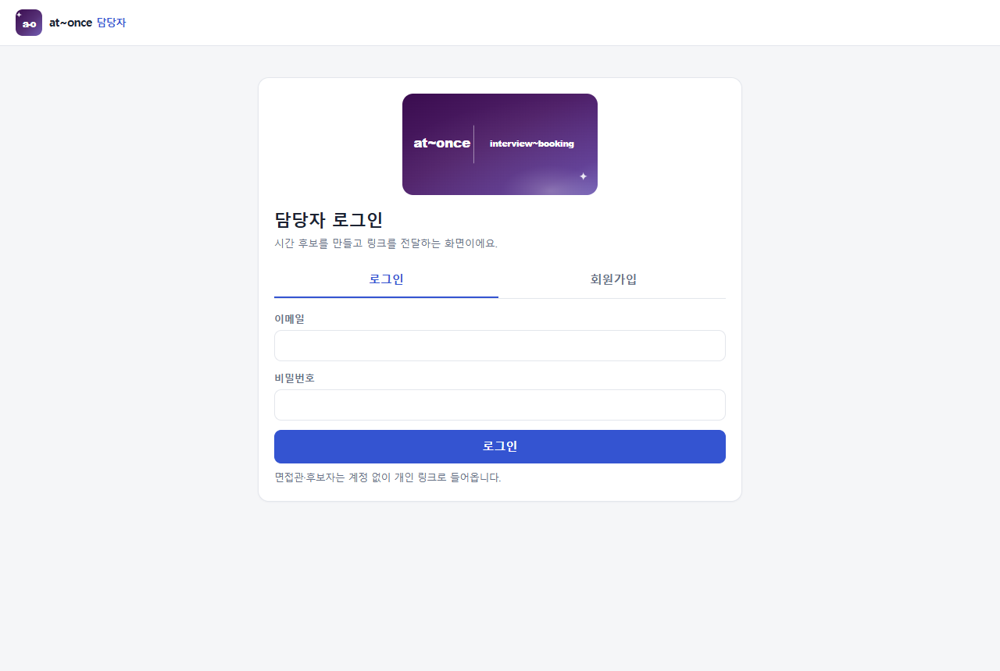
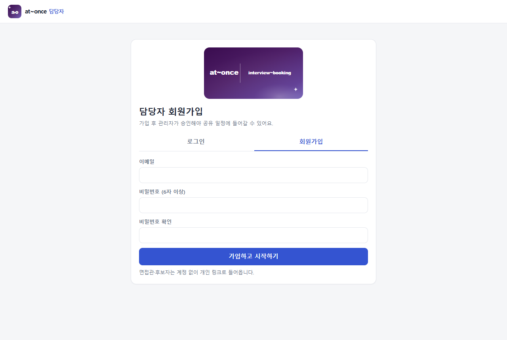
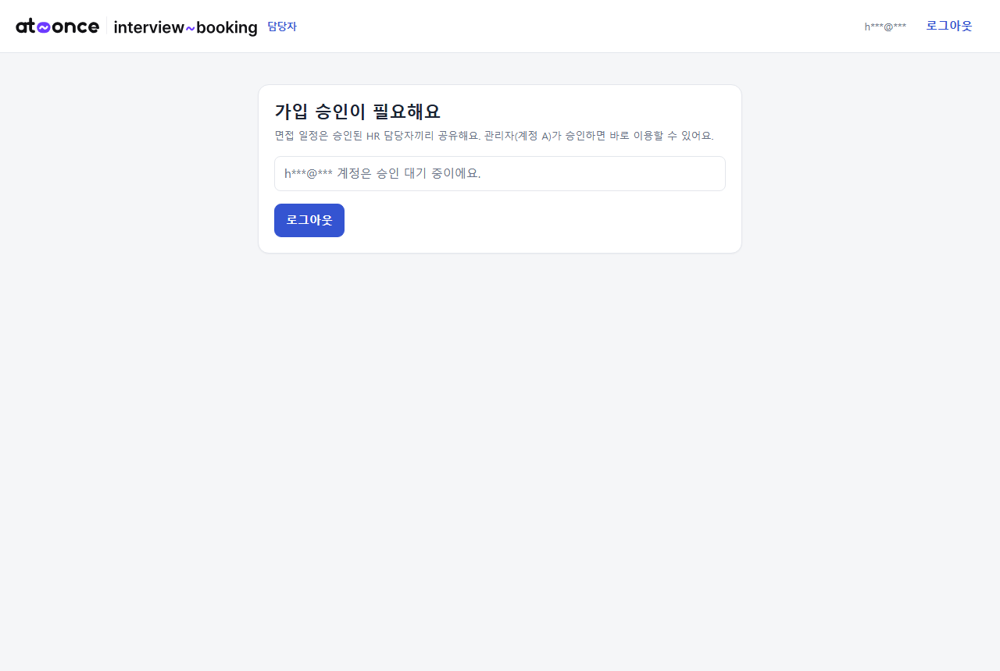
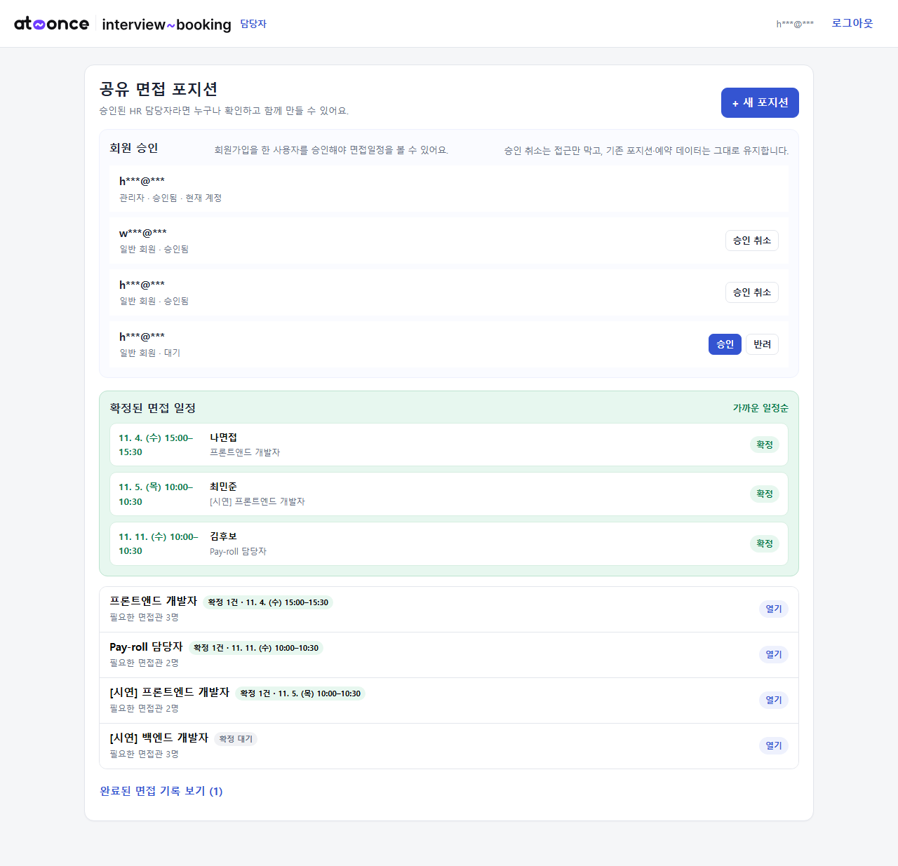
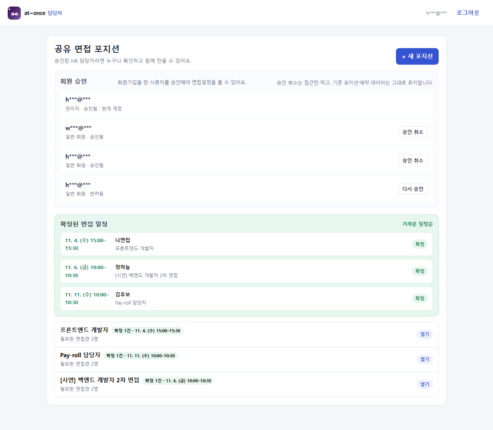
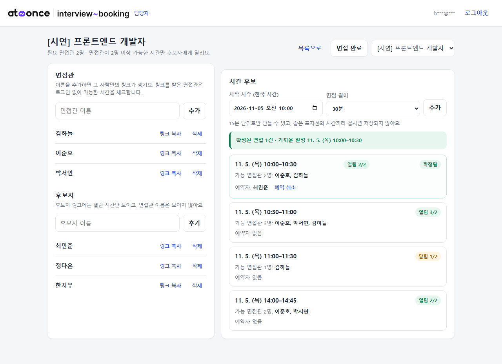
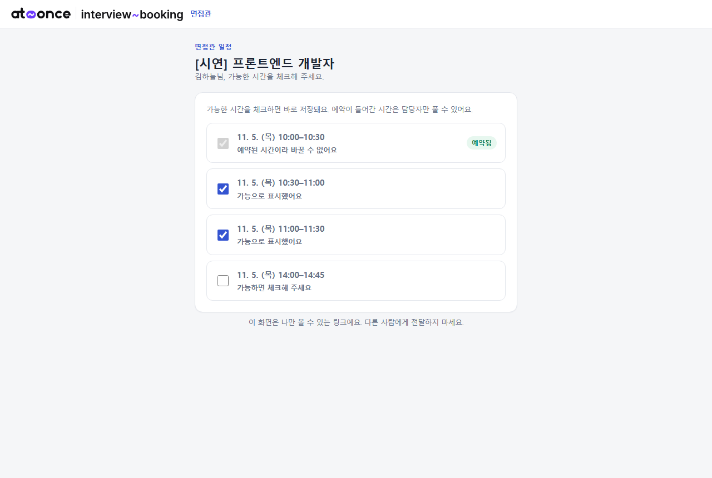
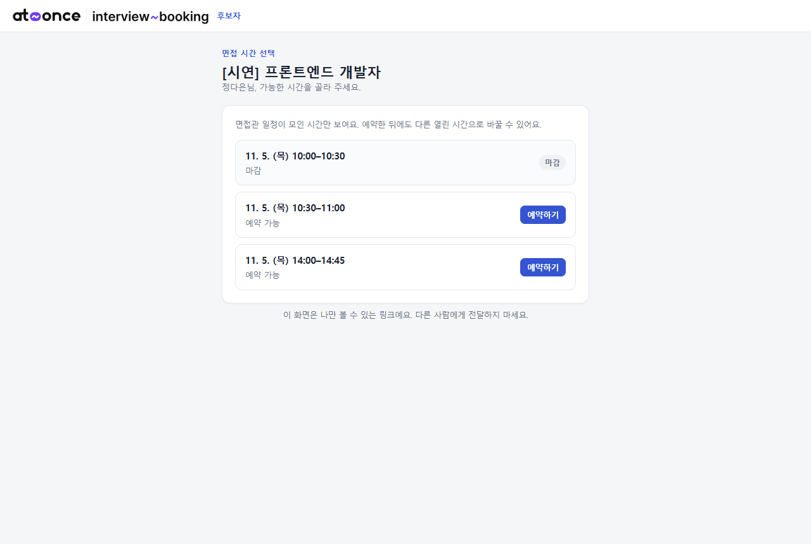

# at~once | interview-booking

> 브랜드명 **at~once** · 서비스명 **interview-booking**

> **면접관 2~3명의 일정이 모인 시간만 후보자에게 열리는 면접 예약 페이지.**
> HR 15년 경력에서 출발한 불편 — 면접 한 건을 잡으려고 메일·메신저를 여러 번 오가고, 시간이 바뀌면 처음부터 다시 조율하고, 같은 시간에 두 후보자가 겹치는 일 — 을 줄이는 서비스예요.

- 배포 주소: [https://basco-git.github.io/aiffel-work/interview-booking/](https://basco-git.github.io/aiffel-work/interview-booking/)
- 기획 문서: [PRD.md](PRD.md) · 설계 이유: [docs/design.md](docs/design.md) · API: [docs/api.md](docs/api.md)
- 회고: [retrospective.md](retrospective.md) · 진행 기록: [docs/progress.md](docs/progress.md)
- 시연: 3분 영상 대신 [상황별 캡처 8장](#시연-상황별-캡처)

## 시연 (상황별 캡처)

> 2026-11-04 배포 주소에서 찍은 화면이에요. 시연용 포지션과 면접관·후보자 이름은 가상이고, 이메일은 가렸어요. 시연 데이터는 캡처 뒤 지웠어요.

| # | 상황 | 화면 |
|---|---|---|
| 1 | 최초 접속: 담당자 로그인 |  |
| 2 | 담당자 회원가입 |  |
| 3 | 가입 직후: 관리자 승인 대기 (승인 전에는 일정을 볼 수 없음) |  |
| 4 | 관리자의 회원 승인 목록 (대기 회원에 승인·반려, 승인 회원에 승인 취소) |  |
| 5 | 반려·승인 취소된 회원을 다시 승인 |  |
| 6 | 포지션 등록 뒤 면접일정 잡기: 면접관·후보자 링크, 시간 후보(15분 단위), 시간별 가능 면접관 수와 확정 예약 |  |
| 7 | 면접관 링크: 가능한 시간 체크, 예약된 시간은 해제 불가 |  |
| 8 | 후보자 링크: 면접관이 모인 시간만 보이고, 예약된 시간은 마감 (면접관 1명뿐인 11:00은 안 보임) |  |

## 사용한 AI 도구

| 단계 | 도구 | 한 일 |
|---|---|---|
| 기초 | Claude Code | 주제 비교, PRD, 작업 규칙(AGENTS.md), 기술 선택, DB 스키마·로컬 규칙 시험 |
| 개발 | opencode + DeepSeek v4.1 | 화면 3개, 실제 규칙 시험 스크립트, 제출 문서, 배포 |
| 후속 개발 | opencode + Pules Alpha | 회원 승인·공유, 목록 개선, 브랜드, 확정 일정 표시, 승인 취소 |
| 최종 확인 | Claude Code | 공유·승인 규칙 재검증(25/25), 제출 전 점검, 캡처, 회고 정리 |

포지션 상세 화면이 저절로 목록으로 돌아가던 오류와, 그때 도구별로 겪은 차이는 [회고 4장](retrospective.md#4-가장-기억에-남는-오류--포지션-상세-화면이-저절로-목록으로-돌아감)에 정리했어요.

## 누가 쓰나

| 사용자 | 들어오는 방법 | 하는 일 |
|---|---|---|
| 승인된 HR 담당자 | 가입 후 관리자 승인 | 공유 포지션의 일정을 만들고 함께 관리하고, 링크를 전달한다 |
| 면접관 (2~3명) | 개인 링크 (로그인 없음) | 가능한 시간을 체크한다 |
| 후보자 | 개인 링크 (로그인 없음) | 열린 시간 중 하나를 예약하거나 바꾼다 |

## 화면 3개

| 화면 | 주소 | 내용 |
|---|---|---|
| 담당자 | `index.html` | 가입 후 관리자 승인·**승인 취소로 접근 차단**·공유 포지션, 면접관·후보자 삭제, 포지션 목록, **확정된 면접 일정 표시**, 시간 후보·예약 취소 |
| 면접관 | `interviewer.html?t=토큰` | 시간 목록에서 가능 체크. 예약된 시간은 잠김 |
| 후보자 | `candidate.html?t=토큰` | 열린 시간만 보이고 예약·변경. 면접관 이름은 보이지 않음 |

## 규칙은 화면이 아니라 DB가 지킨다

| # | 규칙 | 막는 곳 |
|---|---|---|
| R1 | 한 시간에 후보자 한 명 | `bookings.slot_id` 고유 + 예약 함수가 슬롯 행 잠금 |
| R2 | 링크 하나에 예약 하나 (다시 고르면 변경) | `bookings.candidate_id` 고유 |
| R3 | 면접관이 모자란 시간은 예약 불가 | 예약 함수가 가능 인원 확인, 후보자 화면에서도 숨김 |
| R4 | 예약된 시간은 면접관이 해제 불가 | 체크 함수가 예약 여부 확인 |
| R5 | 지난 시간 예약 불가 | 예약 함수가 시작 시각 확인 |
| R6 | 담당자는 자기 것만 | 6개 표 모두 RLS |
| R7 | 링크로는 자기 것만 | anon은 표 접근 불가, 토큰 함수 4개로만 |
| R8 | 비밀값은 코드·저장소에 없음 | `.env`는 `.gitignore`, 브라우저엔 공개 키만 |
| R9 | 시간 겹침 금지·15분 단위 | `slots` 배제 제약(EXCLUDE) + CHECK |

자세한 내용과 규칙별 시험 방법은 [PRD.md](PRD.md) 5장에 있어요.

## 구조

```
interview-booking/
├─ index.html · interviewer.html · candidate.html   화면 3개
├─ assets/
│  ├─ config.js      Supabase Project URL·공개 키 (공개 값만)
│  ├─ app.js         연결·한국 시간 표시·알림·링크 복사
│  ├─ owner.js · interviewer.js · candidate.js      화면별 동작
│  └─ styles.css
├─ supabase/
│  ├─ schema.sql     표 6개·RLS·토큰 함수 4개 (SQL Editor에 붙여 넣어 실행)
│  └─ local-test/    로컬 PostgreSQL에서 규칙 19개를 시험하는 스크립트
├─ scripts/test-rules.mjs   실제 Supabase에 R1~R9를 시험 (npm run test:rules)
├─ docs/             설계·API·설정 순서·진행 기록·시험 결과
├─ PRD.md · retrospective.md
```

## 실행 방법

```bash
# 1) Supabase 설정 (10분): docs/supabase-setup.md
# 2) 화면 설정: assets/config.js 의 SUPABASE_URL, SUPABASE_ANON_KEY 두 줄 채우기 (공개 키만)
# 3) 정적 파일이라 빌드가 없어요. 아무 정적 서버로 열면 됩니다.
npx serve .
# 4) 실제 DB로 규칙 시험 (선택)
npm install
cp .env.example .env   # 시험용 담당자 A·B 계정과 URL·공개 키
npm run test:rules
```

## 평가 기준 대응

| 기준 | 어디에 있나 |
|---|---|
| 1. PRD로 기획 | [PRD.md](PRD.md) — 문제(1장)·타겟 유저(2장)·MVP Must 3(4장)·화면 구성(10장)·데이터 구조(11장) |
| 2. 프론트엔드 (2개 이상 화면) | 화면 3개. 체크·예약·취소가 서버에 저장되고 다시 그려지는 흐름. 담당자 회원가입·로그인 |
| 3. 백엔드/API | Supabase(PostgREST)를 API 서버로 사용, 업무 규칙은 SQL 함수 4개(`interviewer_view`, `set_availability`, `candidate_view`, `book_slot`) — 요청·응답·오류는 [docs/api.md](docs/api.md) |
| 4. DB 연동 | PostgreSQL 표 7개(회원 포함), 1:N·N:M·1:1, RLS, 배제 제약, 저장·조회 흐름 전부 화면과 연결 |
| 5. 배포·새로운 시도 | [GitHub Pages 배포](https://basco-git.github.io/aiffel-work/interview-booking/) · **규칙을 DB에서 강제**(화면 우회 차단) · **회원 승인 + 공유 면접일정** · 동시 예약 10건 시험 · AGENTS.md 규칙 파일과 Claude Code 스킬로 작업 자동화 · 모바일 대응 |

## 교안 1~8 반영

| 교안 | 이 과제에서 한 것 | 증거 |
|---|---|---|
| 1 개발 환경 | Claude Code 작업대, 위험한 작업은 계획 먼저·승인 후 실행 | `AGENTS.md` |
| 2 Git | 브랜치 `interview-booking`, 확인한 것만 커밋, main에는 PR로 | `git log`, `docs/progress.md` |
| 3 세 겹 | HTML 구조·CSS·JS 동작을 나눠 화면 3개 | `index.html`, `assets/` |
| 4 프레임워크 | 프레임워크 채택·기각 비교와 이유 | `docs/design.md` 1장 |
| 5 백엔드·DB | 표 7개 설계, RLS, `.env`, 파라미터 대신 토큰 함수 | `supabase/schema.sql` |
| 6 네트워크·배포 | 공개 URL 배포, 요청·응답·상태 코드 정리, 입력 검증 | `docs/api.md` |
| 7 에이전트 도구 | `AGENTS.md`·`CLAUDE.md` 규칙, 스킬(submit-check·evidence-capture·assignment-wrapup) | `AGENTS.md`, `CLAUDE.md` |
| 8 메인 퀘스트 | 한 문장, Must 3·Won't 6, DB가 지키는 규칙 R1~R9, 검증 기록, 회고, 상황별 캡처 | `PRD.md` 9장, 위 시연 캡처 |

## 진행 과정

| 순서 | 한 일 | 결과 |
|---|---|---|
| 1 | 주제 후보 3개 비교 (면접 일정 예약 / 1on1 피드백 / 강아지 호흡수) | HR 경력과 연결되는 **면접 일정 예약** 선택 |
| 2 | PRD 초안 → 현업 의견 반영 | 면접 15분 단위, 면접관 2~3명 일정 포함, R1~R9 확정 (`721d8de`) |
| 3 | 기술 후보 3개 비교 (Supabase+정적 / Node+SQLite / Firebase) | Supabase + 정적 화면 채택, 이유는 `docs/design.md` (`3178acc`) |
| 4 | DB 스키마 6표 + RLS + 토큰 함수 4개 | 로컬 PostgreSQL에서 규칙 시험 **19/19 통과**, 동시 예약 10건 중 1건 성공 (`3178acc`) |
| 5 | 화면 3개 구현 | 담당자·면접관·후보자 화면, 예약·체크·취소 흐름 (`4513054`) |
| 6 | 실제 Supabase에 규칙 시험 | `npm run test:rules` — R1~R9 21/21 통과 (2026-11-03). 공유·승인으로 바꾼 뒤 R6를 다시 써서 **25/25 통과** (`docs/evidence-live-rules.txt`) |
| 7 | 배포·다른 기기에서 한 바퀴 | 배포 주소 `https://basco-git.github.io/aiffel-work/interview-booking/` **2026-11-03 열림, HTTP 200 확인** |
| 8 | 배포 주소에서 3개 화면 직접 확인 | 배포 주소에서 담당자 로그인·시간 추가·면접관 2명 체크·후보자 예약을 실제 클릭으로 검증, PRD 9장 성공 조건 1~3 기록 (`docs/evidence-deploy-ui.txt`) |
| 9 | 후속 개발 (opencode + Pules Alpha) | 담당자 회원가입·관리자 승인·전원 공유, 확정 일정 표시, 승인 취소 (`cc01777`~`7e672c1`) |
| 10 | 포지션 상세가 저절로 목록으로 가는 오류 | 증상만 막는 커밋 6개 뒤, 5초 자동 갱신이 `true`를 포지션 ID로 넘기던 원인을 찾아 3줄 수정 (`9554dad`) |
| 11 | 최종 확인 (Claude Code) | 승인 규칙 R6 재검증 25/25 (`94a9099`), 제출 전 점검 모두 통과, 상황별 캡처 8장 |

## 회고

- **범위를 먼저 잘랐음** → 캘린더 연동·자동 발송·평가표를 Won't로 두고 "면접관이 모인 시간만 열린다" 하나에 집중함.
- **규칙은 화면이 아니라 DB가 지킴** → 화면을 우회한 요청도 막히는 것을 실제 Supabase 시험 25개로 확인함.
- **도구를 바꿔도 이어 갈 수 있게** → 규칙은 `AGENTS.md` 한 곳, 진행 기록과 인수인계 문서를 커밋마다 남겨 Claude Code ↔ opencode를 오가도 같은 기준으로 작업함.
- **기능을 바꾸면 시험과 기록도 함께** → 공유·승인 전환 뒤 옛 R6 "통과"가 남아 있던 일을 재검증으로 바로잡고 규칙으로 만듦.

### 포지션 페이지 오류 — 증상이 아니라 원인을 찾아야 했던 일

| 구분 | 내용 |
|---|---|
| 증상 | 포지션 상세 화면을 열어 두고 **가만히 있어도** 몇 초 뒤 첫 화면(포지션 목록)으로 저절로 넘어감 |
| 헛짚은 시도 | opencode + Pules Alpha에 수정을 맡겼지만 원인을 못 찾고 스와이프·뒤로가기만 의심 → 20여 분 동안 증상만 막는 커밋 6개(`b1421f1`~`a2925a9`), 토큰만 소비 |
| 진짜 원인 | 5초마다 도는 자동 갱신이 `loadPositions(true)`를 불러, `true`를 '유지할 포지션 ID'로 잘못 읽고 목록으로 돌아감 |
| 해결 | 직접 개발자 테스트를 반복하고 인터넷 검색을 함께 써서 원인을 좁힌 뒤, 지금 보던 포지션 ID를 넘기도록 **3줄 수정** (`9554dad`) |
| 배운 점 | "가만히 있어도 넘어간다"는 증상 자체가 사용자 입력과 무관하다는 단서였음. 같은 방향으로 두 번 실패하면 멈추고 다시 관찰하기. 원인 추적 능력은 모델마다 차이가 큼(테스트 모델은 화면 생성은 빨랐지만 디버깅은 약했음) |

자세한 회고는 [retrospective.md](retrospective.md)에 있어요.
