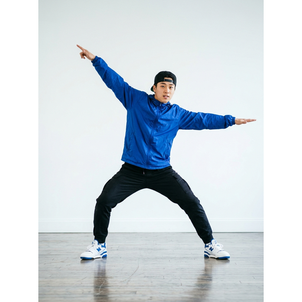
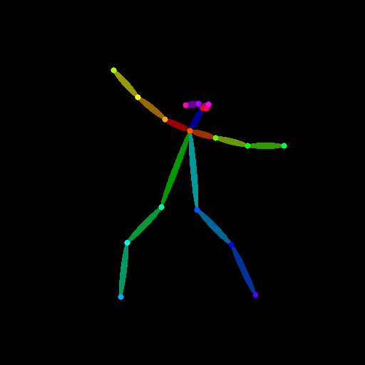
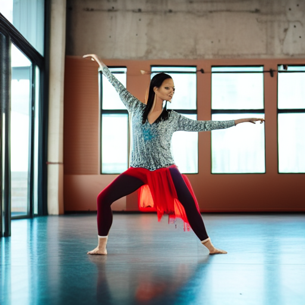
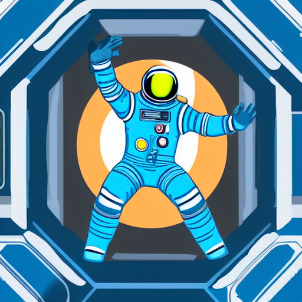
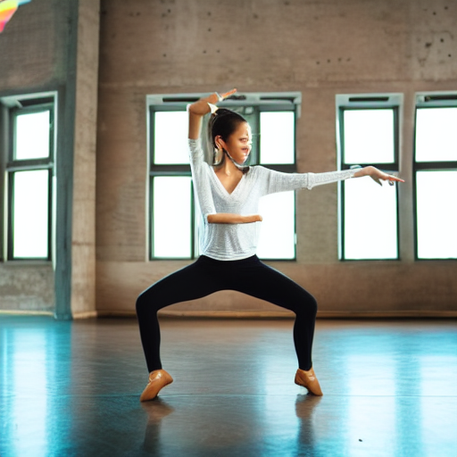
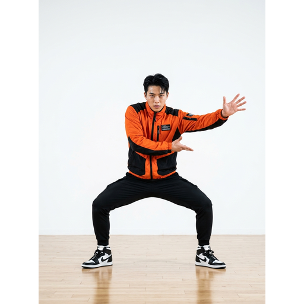
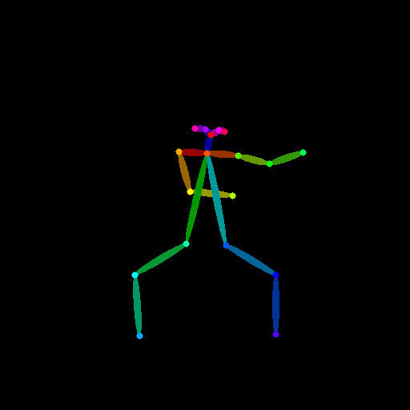
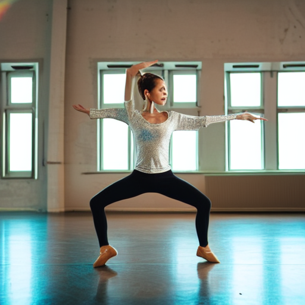
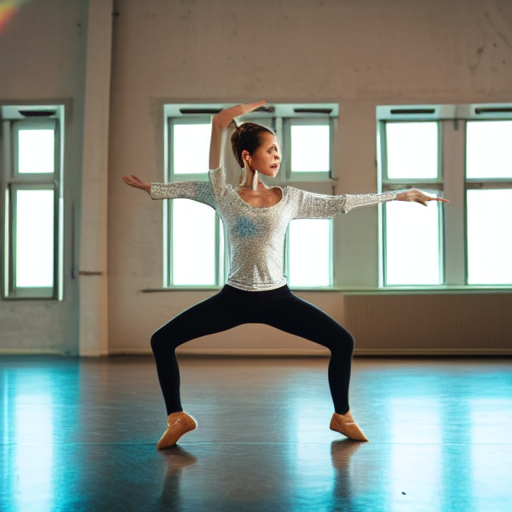

# 원하는 포즈로 이미지 만들기

> **진행 중**: 포즈 추출과 생성은 Colab에서 실행했지만, 이미지 품질 개선과 결과 파일 정리·과제 제출은 아직 남아 있습니다.

> 공개 범위: 이 문서와 출력이 없는 실험 노트, AI로 생성한 스튜디오 참조 이미지와 그 실험 결과를 올립니다. 초기 사진과 실행 완료 노트 등 나머지 파일은 로컬에 보관하며 공개 전 출처와 출력 내용을 확인합니다.

## 과제 목표

참조 사진에서 사람의 포즈를 추출해 생성 조건으로 전달하고, 비슷한 자세의 새로운 이미지를 만드는 Colab 튜토리얼을 작성합니다. 같은 포즈에 다른 프롬프트를 적용한 결과와 다른 포즈에 같은 프롬프트를 적용한 결과를 비교해 노트 마지막에 기록합니다.

원문 기준 제출물은 `README.md`, `pose_tool.ipynb`, `samples/`, `prompts.md`가 있는 공개 GitHub 저장소의 URL입니다. 원문에 적힌 마감은 **2026-11-18 23:59 (한국 시간)**이며, LMS의 최신 안내도 확인합니다.

## 현재 파일과 실행 구성

| 파일 | 내용 | 상태 |
|---|---|---|
| `pose_tool.ipynb` | 원본 FLUX.2-klein 4B + ComfyUI 이미지 생성 노트 | 로컬 보관. 기존 텍스트 이미지 생성 확인, 포즈 조건 기능은 없음 |
| `pose_controlnet_colab_실습전.ipynb` | OpenPose + ControlNet 포즈 생성 실습 초안 | 공개용 실행 전 노트. 실행 완료 노트는 로컬 보관, 패키지 설정 보완 필요 |
| `pose_submission_draft.ipynb` | 제출용 별도 초안 | 기존 노트를 보존하고 실행 완료 노트의 설치 명령과 03번 실험 관찰을 반영. 새 세션 재실행은 아직 필요 |
| `pose_sdxl_experiment.ipynb` | SDXL + 호환 OpenPose ControlNet 별도 개선 실험 | 모델 로드 후 생성 중 RAM 부족으로 종료. 인페인팅은 미포함 |
| `pose_light_experiment_실습전.ipynb` | SD 1.5에서 포즈 조건 적용 시점을 비교하는 별도 실험 | 공개용 실행 전 노트. Colab T4에서 실행했으나 얼굴 품질은 여전히 아쉬움 |
| `experiments/04-light-pose-a/`, `05-light-pose-b/` | 가벼운 비교 실험 결과 | 포즈별 원본·뼈대·결과 두 장·설정 보관 |
| `experiments/` | 다운로드한 SD 1.5 실험 결과 | 스튜디오 포즈 결과 공개, 초기 춤 사진 결과는 로컬 보관 |
| `samples/`, `prompts.md` | 03번 실험 이미지 사본과 프롬프트·관찰 | 제출용 초안으로 정리. 새 실행 결과는 아님 |
| `image/` | 포즈 실험에 사용하거나 준비한 이미지 | 스튜디오 사진 두 장은 안티그래비티로 생성한 이미지. 나머지 이미지는 로컬 보관 |

두 노트는 다른 실행 경로입니다. 원본 노트의 FLUX.2-klein에 SD 1.5용 ControlNet을 그대로 결합하지 않고, 원문에서 허용한 비슷한 모델 경로로 [Stable Diffusion 1.5](https://huggingface.co/stable-diffusion-v1-5/stable-diffusion-v1-5)와 [OpenPose ControlNet](https://huggingface.co/lllyasviel/control_v11p_sd15_openpose)을 사용해 시험했습니다. 최종 노트 이름은 제출 조건에 맞게 정리해야 합니다. 각 모델 카드와 라이선스·사용 조건을 확인합니다.

## 원하는 포즈로 만들기 진행 과정

| 순서 | 한 일 | 확인한 결과 |
|---|---|---|
| 1 | 과제와 기존 Colab 확인 | 기존 FLUX.2-klein + ComfyUI는 텍스트 이미지 생성용이며 포즈 입력이 없어 별도 조건 연결이 필요했음 |
| 2 | 기존 생성 기능부터 검증 | Gradio 7860 포트 충돌을 고정 포트 지정 제거로 대응한 뒤 이미지 한 장 생성에 성공함 |
| 3 | 호환 포즈 생성 경로 구성 | FLUX.2-klein에 SD 1.5용 ControlNet을 그대로 붙이지 않고 SD 1.5 + OpenPose ControlNet으로 사진·뼈대·생성을 연결함 |
| 4 | 설치 오류 해결 후 첫 포즈 시험 | `tokenizers` 빌드 오류에 대응해 설치 버전을 변경함. 설치는 성공했지만 Gradio 의존성 충돌 경고가 남았음. 역동적인 자세는 관절 누락·겹침과 부자연스러운 팔다리가 나타남 |
| 5 | 추출과 생성 문제를 나눠 확인 | 밝은 배경의 단독 댄서 A·B 이미지를 새로 사용함. 뼈대는 더 알아보기 쉬워졌지만 B 결과는 여분의 팔이 생기고 얼굴이 흐릿했음 |
| 6 | 생성 설정과 조건 비교 | 시드 42를 유지하며 스텝·포즈 조건 강도를 조정하고 A1·A2·B1을 비교함. 0.8·0.5의 관찰은 대화에 남아 있으나 해당 파일의 설정 대응은 확인하지 못함 |
| 7 | 더 큰 모델 시험 | 얼굴·신체 개선 가능성을 보려고 SDXL을 시도함. 가중치 파일명 오류를 다른 SDXL용 ControlNet으로 해결했으나 생성 중 Colab RAM 부족으로 세션이 종료됨 |
| 8 | 가벼운 방식으로 재비교 | SD 1.5에서 포즈 조건 적용 종료 시점만 1.0·0.8로 바꿔 A·B를 시험함. 두 설정은 큰 차이가 없었고 B에는 여분의 팔이 남았음 |

## 왜 여러 번 바꿔 봤을까?

첫 결과가 어색했을 때 **사진에서 관절을 잘못 추출한 것인지, 뼈대는 맞지만 생성 모델이 잘못 그린 것인지** 구분할 필요가 있었습니다. 그래서 역동적인 사진을 밝고 팔다리가 잘 보이는 사진으로 바꿔 뼈대부터 확인했습니다. 그 뒤에도 B의 팔과 얼굴이 부자연스러워 포즈 조건과 생성 설정을 비교했고, 숫자 조정만으로 개선되지 않자 모델을 바꾸는 방안도 시험했습니다.

`steps`는 생성 중 계산 단계 수, `control_strength`는 포즈 조건의 반영 강도입니다. `seed`는 무작위 출발점을 정합니다. 원인을 비교할 때는 **바꾸려는 값 하나를 제외한 조건을 유지**해야 합니다. 초기에 여러 값을 함께 바꾼 결과는 원인을 하나로 나눌 수 없고, SDXL 시도는 모델과 해상도가 함께 달라 단일 원인을 비교할 수 없습니다.

## 실제 결과: 사진 → 뼈대 → 생성

### A 포즈: 큰 자세는 따라가지만 얼굴은 작고 흐릿함

| 참조 A | 추출한 뼈대 A | 생성 A1 |
|---|---|---|
|  |  |  |

참조 이미지의 팔과 다리 방향은 뼈대에 대체로 나타났고, 결과에서도 벌린 자세를 알아볼 수 있습니다. 다만 512×512 전신 이미지에서 얼굴이 작고 선명하지 않았습니다. 이것이 포즈 강도 하나 때문이라고 단정하지 않았습니다.

### 과제 조건 비교: 같은 포즈·다른 프롬프트 / 다른 포즈·같은 프롬프트

| A1 · 포즈 A + 댄서 | A2 · 포즈 A + 우주인 | B1 · 포즈 B + 댄서 |
|---|---|---|
|  |  |  |

이 세 결과는 같은 [설정 기록](experiments/03-studio-steps30-control1/experiment_settings.json)에 따라 `seed=42`, `steps=30`, `control_strength=1.0`으로 생성됐습니다. A1과 A2는 같은 뼈대에 프롬프트를 바꾸자 댄서 사진과 우주인 일러스트로 달라졌습니다. A1과 B1은 같은 댄서 프롬프트에서 뼈대를 바꾼 비교지만, B의 몸 앞 팔 동작이 정확히 재현됐다고 보기는 어렵습니다.

### B 포즈: 뼈대가 보이더라도 신체가 정확하지 않을 수 있음

| 참조 B | 추출한 뼈대 B | 조건 적용 100% | 조건 적용 80% |
|---|---|---|---|
|  |  |  |  |

팔이 몸 앞을 지나는 B 이미지로 포즈 조건 적용을 끝까지 유지한 결과와 80%까지만 적용한 결과를 비교했습니다. 두 그림 모두 **팔이 세 개처럼 보이는 문제**가 남았고, 눈에 띄는 개선은 없었습니다. 뼈대가 생성의 조건이지 관절을 정확히 고정하는 보장은 아니라는 한계가 드러났습니다.

공통 설정은 `seed=42`, `steps=30`, `control_strength=0.8`, `guidance_scale=7.5`, 512×512, Tesla T4이고 `control_guidance_end`만 바꿨습니다. [B 설정 기록](experiments/05-light-pose-b/settings.json) · [A 설정 기록](experiments/04-light-pose-a/settings.json)

## 오류와 대응 기록

| 상황 | 왜 확인했나 / 어떻게 대응했나 | 남은 점 |
|---|---|---|
| Gradio `7860` 포트 충돌 | 기존 FLUX 이미지 생성부터 되는지 확인하던 중 발생. `server_port=7860`을 제거해 빈 포트를 찾도록 한 뒤 이미지 생성 확인 | 기존 FLUX 노트에는 포즈 제어가 없음 |
| `tokenizers` 빌드 실패 | SD 1.5 실습 초안의 고정 버전 설치가 현재 Colab과 맞지 않았음. 설치 버전을 바꿔 설치 성공 메시지를 확인 | 기존 Gradio와 `huggingface-hub` 의존성 충돌 경고가 있었으며, 포즈 실습은 Gradio를 쓰지 않음 |
| SDXL 가중치 파일 오류 | `thibaud` 저장소에서 지정한 이름의 Diffusers safetensors를 찾지 못함. 해당 파일이 있는 `xinsir` SDXL용 모델로 변경 | 모델 로드가 된 것과 결과 생성 성공은 별개 |
| `pipe` 변수가 없음 | 모델 로드 출력과 현재 런타임 상태가 다른지 확인함. 진단 셀로 변수가 없는 것을 확인하고 로드 후 다시 존재함을 확인 | 런타임이 재시작되면 사진·뼈대·모델 변수도 사라짐 |
| SDXL 실행 중 Colab RAM 부족 | 더 좋은 얼굴·신체 표현을 기대해 시도했지만 이미지 생성 중 세션이 종료됨 | SDXL 생성 결과는 없음. 기존 SD 1.5로 돌아가 비교함 |

## 실험 비교 계획

다운로드한 설정 파일을 기준으로 묶음을 정리했습니다. 첫 세 폴더는 `experiment_settings.json`, 가벼운 비교 폴더는 `settings.json`에 설정이 있습니다. 01번은 로컬에만 있고 02~05번은 저장소에 공개되어 있습니다.

| 결과 폴더 | 사진 | steps | control_strength | seed |
|---|---|---:|---:|---:|
| `experiments/01-dynamic-steps25-control1/` | 역동적인 춤 포즈 | 25 | 1.0 | 42 |
| `experiments/02-studio-steps25-control1/` | 밝은 스튜디오 포즈 | 25 | 1.0 | 42 |
| `experiments/03-studio-steps30-control1/` | 밝은 스튜디오 포즈 | 30 | 1.0 | 42 |
| `experiments/04-light-pose-a/` | 스튜디오 포즈 A | 30 | 0.8 | 42 |
| `experiments/05-light-pose-b/` | 스튜디오 포즈 B | 30 | 0.8 | 42 |

앞의 세 묶음에는 0.8·0.5 설정이 없으며, 이후 가벼운 비교의 A·B 폴더에는 0.8 설정이 확인됩니다. 이전 대화의 0.5 결과 파일과 설정의 대응은 아직 확인하지 못했습니다. 가벼운 비교는 각 폴더 안에서 `control_guidance_end` 1.0과 0.8을 비교합니다.

| 결과 | 포즈 | 프롬프트 | 비교 |
|---|---|---|---|
| A1 | A | 1 | 기준 결과 |
| A2 | A | 2 | A1과 비교: 같은 포즈, 다른 프롬프트 |
| B1 | B | 1 | A1과 비교: 다른 포즈, 같은 프롬프트 |

프롬프트와 이미지, 시드·스텝·가이던스·ControlNet 강도·모델명·실행 환경을 함께 기록합니다. 비교할 때는 바꾸려는 조건 외의 설정을 유지하고, 결과에 나타난 차이를 직접 확인합니다. 실험 결과나 성공 여부는 추측해 쓰지 않습니다.

## 회고 (진행 중)

- 뼈대 추출이 잘못되면 그 조건을 받은 생성 결과도 원하는 자세와 달라질 수 있음을 확인함. 다만 생성 모델 자체의 한계도 있으므로 하나의 원인으로 단정하지 않음.
- 인물이 한 명이고 배경과 팔다리가 잘 보이는 이미지에서 이전보다 뼈대를 알아보기 쉬웠음.
- 512×512 전신 결과에서 얼굴이 작고 흐릿했으며, 몸 앞을 지나는 팔 주변의 생성도 부자연스러웠음. 포즈 추출과 이미지 생성의 한계를 나누어 확인할 필요가 있음.
- B 포즈에서 조건 적용 종료 시점을 1.0과 0.8로 바꿔도 두 결과 모두 여분의 팔이 생겼음. 단순 설정 변경만으로 개선됐다고 말할 수 없음.
- 고정된 구버전 설치가 Colab 환경과 맞지 않아 설치 오류가 발생함. 변경한 패키지 조합의 충돌 경고를 해결하거나, 노트에서 Gradio가 필요 없는 이유를 설명하고 실제 재실행을 검증해야 함.

## 남은 작업

- [x] 로컬 실행 완료 노트의 설치 명령을 확인해 별도 제출 초안에 반영하기 (설치 명령은 일부 버전 범위만 지정)
- [ ] 실제 설치된 전체 패키지 버전을 확인하고 새 Colab 세션에서 초안을 재실행하기
- [x] A1·A2·B1의 원본·뼈대·생성 이미지를 `samples/`에 모으고 `prompts.md`에 비교 기록하기 (기존 03번 실험 사본)
- [ ] 얼굴과 관절 문제를 개선할 방법을 한 번에 하나씩 바꿔 시험하고 기록하기
- [x] 별도 제출 초안의 마지막 마크다운 셀에 기존 03번 실험 관찰과 실패 사례 적기 (새 재실행 관찰은 아님)
- [ ] 최종 제출 노트를 `pose_tool.ipynb`로 정리하되 기존 원본을 덮어쓰기 전 보존 방법 확인하기
- [x] 기존 공개 03번 결과로 `samples/`와 `prompts.md` 초안 준비하기
- [ ] 이미지 출처·공개 권리, 비밀값과 개인정보를 최종 확인하기
- [ ] 과제 파일을 브랜치에 올려 PR을 만들고, 병합 후 LMS에 저장소 URL 제출하기
