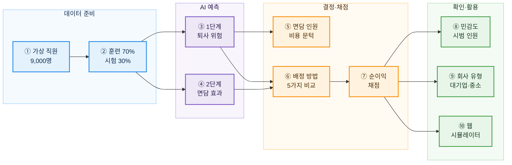
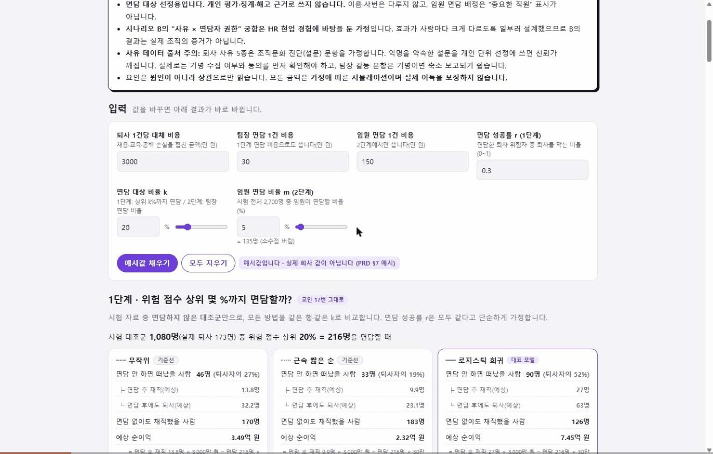
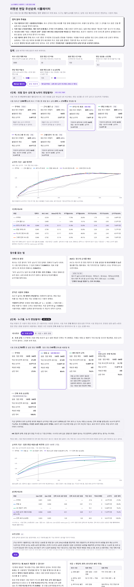
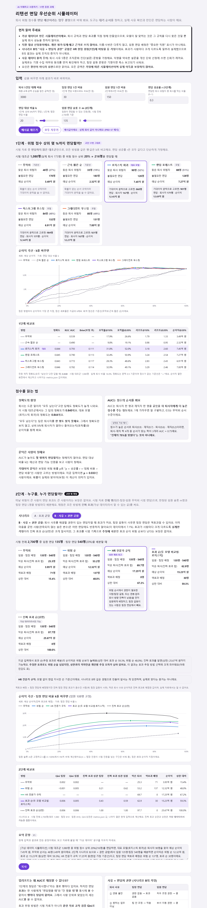

# retention-planner — 누구를, 누가 면담해야 퇴사를 막을까

> **공개 웹 주소: <https://basco-git.github.io/aiffel-work/retention-planner/?example=1>** (예시값이 채워진 상태로 열림)
> 퇴사 위험 점수를 "누구를, 누가 면담할지"라는 예산 결정으로 바꿔 보는 분석과 웹 시뮬레이터입니다.

> ⚠️ 모든 결과는 **직접 만든 가상 데이터**에서 나왔고, 실제 회사의 성능을 뜻하지 않습니다. 점수는 **면담 대상의 우선순위**를 정하는 데만 씁니다. 개인 평가·징계·해고의 근거로 쓰지 않습니다. 분석에서 나온 요인은 원인이 아니라 함께 움직이는 관계(상관)입니다.

시연 영상과 화면 캡처는 [7. 실행 방법과 시연](#시연)에, 과제 채점 기준별 위치는 [8. 문서 안내](#8-문서-안내)에 있습니다.

## 1. 한눈에 보기

**무엇을 했나**
- 가상 직원 9,000명을 만들어, 퇴사 위험을 예측하고(1단계), 한정된 면담을 누구에게 누가 할지 배정했습니다(2단계).
- 배정 방법 5가지를 같은 시험 자료로 비교하고, **면담 후 재직(예상) 인원과 순이익**으로 채점했습니다.
- 회사 유형, 시범 인원, 실패 사례, 실제 사례 7건으로 결론이 유지되는지 확인했습니다.

**핵심 결론 3가지**
1. **몇 명을 면담할지는 모델이 아니라 회사의 비용이 정합니다.** 예시 비용에서는 퇴사 확률 3.3%만 넘어도 면담하는 쪽이 이득이었습니다(면담 성공률 30% 가정).
2. **면담 효과가 퇴사 사유마다 다르면 "위험한 사람부터"는 최선의 절반에 그칩니다.** 사유에 맞는 면담자(팀장/임원)를 고르는 쪽이 40% 더 나았습니다(가상 시나리오 B 기준).
3. **우리 회사가 어느 경우인지는 데이터로만 알 수 있습니다.** 그래서 무작위 시범 면담 기록을 쌓는 것이 다음 단계입니다.

## 2. 왜 이 프로젝트를 했나

**업무 문제**

> 퇴사 위험 점수가 **직원 리텐션(퇴사 방지) 관리의 판단 근거**로 쓸 만한지 검증합니다.
> "면담하면 퇴사를 일부 막을 수 있다"는 가정 아래, 한정된 **면담 예산과 임원 시간**을 **누구에게, 누가** 면담하도록 나눠야 가장 효과적인지 실험합니다.

인사팀은 퇴사 징후가 있는 직원과 면담하고 싶지만, 시간과 예산이 한정돼 **누구부터** 볼지 정해야 합니다. 특히 실장·본부장·대표 같은 임원의 면담 시간은 비싸고 적습니다.

**현업 경험 (HR 15년)**
- 면담 효과는 사람마다 다르고, 면담자 직위가 높을수록 큽니다.
- 주요 퇴사 사유는 ① 연봉 ② 원하는 업무 ③ 복지·보상 ④ 팀장 등과의 갈등 ⑤ 회사 방향·성장입니다.
- 직위가 높을수록 효과가 큰 이유는 **사유를 해결할 권한**(처우 조정, 부서 이동, 비전 공유)이 있기 때문입니다. 같은 논리로, 팀장 갈등이 사유라면 팀장 면담은 역효과일 수 있습니다.
- 그리고 "사람마다 다른데 통계로 잡아낼 수 있을까?"라는 의문이 있었습니다. 이 의문이 분석의 중심 질문이 되었습니다.

**국내 연구 근거:** 연봉·복지·직무 만족이 낮을수록 이직이 많습니다(정규직 청년 이직률 대기업 17.2%, 중소기업 약 25%). 같은 회사 안에서도 만족도가 이직에 영향을 줍니다. 출처는 [문제 정의서 참고 자료](docs/PROBLEM.md#8-참고-자료)에 있습니다.

자세히: [문제 정의서](docs/PROBLEM.md) (도메인, 현재의 문제, 개선 가설, 대상 사용자, 성공 기준)

## 3. 실험 설계

### 가상 데이터를 쓴 이유

면담 기록은 회사 안에서도 **볼 수 있는 사람이 정해져 있는 자료**입니다.

| 누가 | 볼 수 있는 범위 |
| --- | --- |
| 인사팀 중 권한을 받은 소수 | 전체 기록. 인사팀 안에서도 업무의 난이도와 비중을 따져 **아는 사람을 최소한으로** 둠 |
| 조직장 | 자기 조직 구성원의 면담 내용 |
| 대표 | 전체. 별도 보고서로 요약해 전달받는 회사도 있음 |

이렇게 회사 안에서도 권한에 따라 나눠 보는 자료를, 이 프로젝트에서는 쓸 수 없습니다.
1. **공개된 환경입니다.** 이 프로젝트는 회사라는 닫힌 환경이 아니라, 누구나 볼 수 있는 GitHub 저장소와 웹에 올라갑니다.
2. **면담 내용은 개인정보입니다.** 이름을 지워도 사유·직급·시기를 맞춰 보면 누구인지 알 수 있습니다.
3. **"면담했으면 남았을까"는 실제 기록으로 증명하기 어렵습니다.** 한 사람에게 면담한 경우와 안 한 경우를 동시에 해 볼 수 없기 때문입니다.

그래서 가상 직원 9,000명을 직접 만들었습니다. 가상 데이터는 직원마다 **"면담했을 때"와 "안 했을 때"의 퇴사 확률을 모두 알고 있어서**, 어떤 배정 방법이 실제로 더 많은 퇴사를 막는지 채점할 수 있습니다. 생성 규칙의 방향은 국내 연구에 맞췄고, 작성자의 실제 사례 7건으로 같은 방향인지 확인했습니다.

### 시나리오 A와 B

같은 직원 9,000명으로, **면담 효과 규칙만 다르게** 두 번 만들었습니다. 실제 회사가 어느 쪽인지 모르기 때문에 두 경우의 결론을 나란히 봅니다.

| | 시나리오 A: 효과 균일 | 시나리오 B: 사유 × 권한 궁합 |
| --- | --- | --- |
| 면담 효과 | 누구에게나 같음. 임원 면담은 언제나 팀장 면담의 2배 | 퇴사 사유와 면담자 권한에 따라 다름 |
| 예 | 연봉 불만이든 팀장 갈등이든 팀장 면담 효과가 같음 | 연봉·업무·회사 방향 불만 → 임원 면담 효과가 큼(처우 조정·부서 이동 권한). 팀장 갈등 → 팀장 면담은 **역효과** |
| 이미 마음을 굳힌 사람 | 없음 | 7.1%. 어떤 면담에도 반응하지 않음(모델은 볼 수 없음) |
| 평균 면담 효과 | 같게 맞춤 | 같게 맞춤 |
| 퇴사율 | 면담 없음 16.1%, 팀장 면담 12.2%, 임원 면담 8.8% | 면담 없음 16.1%, 팀장 면담 13.1%, 임원 면담 8.1% |
| 가장 나은 배정 | **위험 순** | **HR 전문가 규칙** → 효과 예측 → 위험 순 |

시나리오 B의 궁합은 HR 현업 경험에 바탕을 둔 가정입니다. 그래서 B의 결과는 실제 조직의 증거가 아니라 "이런 구조라면"의 결과입니다.

### 비교한 배정 방법

| 방법 | 어떻게 고르나 | 성격 |
| --- | --- | --- |
| 무작위 | 아무렇게나 | 기준선(아무것도 모를 때) |
| 위험 순 | 퇴사 위험 점수가 높은 사람부터 임원 → 팀장 | 기준선(교안 17번 방식 그대로) |
| HR 전문가 규칙 | 위험 점수 순서로 보되, 권한이 필요한 사유(팀장 갈등, 연봉·업무·방향 불만)면 임원 면담, 팀장 갈등이 있으면 팀장 면담 제외 | 위험 점수(AI) + 현업 사유 규칙 |
| 효과 순(추정) | 시범 면담 기록으로 "면담하면 얼마나 남을까"를 예측해 큰 사람부터 | AI 방법(면담 효과 예측, 업리프트) |
| 진짜 효과 순(상한) | 진짜 면담 효과가 큰 사람부터 | 최대치. 가상 데이터라서만 계산 가능 |

1단계 퇴사 위험 점수는 로지스틱 회귀, 랜덤 포레스트, 부스팅 2종, **TabICL(사전학습 표 모델)**을 같은 시험 자료로 비교해, 훈련 자료의 교차 검증 성적이 가장 좋은 **로지스틱 회귀**를 썼습니다.

### 분석 흐름도



**색 규칙:** 🟦 파랑 = 데이터 준비 · 🟪 보라 = AI 예측(모델) · 🟧 주황 = 결정·채점(비용과 배정) · 🟩 초록 = 확인·활용(반복 검증과 웹)

| 번호 | 하는 일 |
| --- | --- |
| ① | 퇴사 사유·근무 조건을 가진 가상 직원 9,000명을 만들고, 시범 면담(면담 없음·팀장·임원)을 무작위로 배정 |
| ② | 70%는 훈련 자료(연습 문제), 30%는 시험 자료(본시험)로 한 번 나누고 끝까지 고정 |
| ③ | 1단계: "면담 안 하면 떠날 확률"(퇴사 위험 점수)을 예측 |
| ④ | 2단계: "면담하면 얼마나 남을까"(면담 효과)를 시범 면담 기록으로 예측 |
| ⑤ | 회사 비용으로 몇 명을 면담할지 문턱을 정함 |
| ⑥ | 위의 배정 방법 5가지를 비교 |
| ⑦ | 같은 시험 자료, 같은 인원으로 면담 후 재직(예상)과 순이익을 채점 |
| ⑧ | 시범 인원을 바꿔 반복: 몇 명이면 판단이 서나 |
| ⑨ | 대기업형·중소기업형으로 반복: 결론이 유지되나 |
| ⑩ | 웹 시뮬레이터: 비용·인원을 바꿔 바로 계산 |

AUC, 문턱, 기준선, 훈련·시험 자료 같은 개념은 [개념 안내](docs/CONCEPTS.md)에 우리 숫자로 풀어 두었습니다. 설계에 넣은 가정 11개도 그 문서에 있습니다.

## 4. 결과

| 질문 | 답 |
| --- | --- |
| **Q1.** 퇴사 위험을 잘 줄 세울 수 있나? | 가장 단순한 **로지스틱 회귀**가 훈련 교차 검증 기준으로 가장 나아 대표 모델이 되었습니다(시험 AUC 0.793). 상위 20%를 면담하면 떠났을 사람의 52%를 찾습니다(무작위 27%, 근속 짧은 순 19%). TabICL은 시험 AUC가 0.002 높았지만(0.795) 교차 검증에서는 낮았고(0.801 대 0.804) 실행에 약 23분이 걸렸습니다. 정확도(84%)는 "모두 남는다"고만 해도 나오는 값이라 기준이 될 수 없었습니다. |
| **Q2.** 몇 명을 면담해야 하나? | 면담하지 않은 시험 1,080명 중 상위 20%(216명)를 면담하면(면담 성공률 30% 가정) 면담 후 재직(예상) 27명, 순이익 7.45억 원입니다. **비용 기준**(이득이 나는 사람은 모두, 860명)으로 고르면 12.45억 원으로 더 큽니다. |
| **Q3.** "면담하면 남을 사람"을 고르면 나은가? | 효과가 같으면(A) 위험 순이 최고입니다. 사유마다 다르면(B) 면담 효과 예측이 위험 순보다 24% 높았습니다. |
| **Q4.** 시범 면담 기록이 몇 명이면 되나? | 사유별 효과 차이가 크면 **9,000명**으로도 위험 순을 넘었습니다(3번 모두). 차이가 없으면 30만 명이어도 넘지 못했습니다. |
| **Q5.** 위험 점수에 현업 규칙(사유 × 권한)을 더하면? | B에서 위험 순보다 **40% 높아 가장 나았고**, 역효과 우려가 0명이었습니다. 단, 규칙과 시나리오 B를 같은 현업 경험으로 만들어 앞서는 게 당연한 면이 있습니다. |
| **Q6.** 회사 유형이 달라도 같나? | 대기업형·중소기업형 모두 A는 위험 순, B는 HR 규칙이 최고였습니다. 연봉·복지 만족이 낮은 회사일수록 면담의 이익이 컸습니다. |

**2단계: 시나리오별 배정 방법 비교** (시험 자료 2,700명, 임원 135명·팀장 540명 면담)

<!-- 표:2단계 -->
| 방법 | A 순이익 | A 면담 후 재직(예상) | B 순이익 | B 면담 후 재직(예상) | B 역효과 우려 | B 최대치 대비 |
| --- | --- | --- | --- | --- | --- | --- |
| 무작위 | 4.57억 | 27.4명 | 3.95억 | 25.3명 | 71명 | 15% |
| 위험 순 | 13.60억 | 57.5명 | 12.32억 | 53.2명 | 137명 | 48% |
| HR 전문가 규칙 | 12.88억 | 55.1명 | 17.25억 | 69.7명 | 0명 | 67% |
| 효과 순(추정) | 11.87억 | 51.7명 | 15.23억 | 62.9명 | 30명 | 59% |
| 진짜 효과 순(상한) | 16.91억 | 68.5명 | 25.67억 | 97.7명 | 0명 | 100% |

입력: 팀장 면담 20%, 임원 면담 비율 5%(135명), 대체 비용 3,000만 원, 팀장 30만 원, 임원 150만 원. 면담 후 재직(예상)과 순이익은 진짜 효과로 채점(사람별 확률의 합이라 소수가 나옴). 역효과 우려 = 팀장 면담을 받으면 오히려 퇴사 확률이 오르는 사람(팀장 갈등)에게 팀장 면담을 배정한 수. 최대치 = 진짜 효과를 알 때의 순이익.
<!-- /표:2단계 -->

**회사 유형별 결과** (연봉·복지 만족만 바꾼 회사, 시드 3개 평균)

| 회사 유형 | 면담 없음 퇴사율 | A 최고 방법 | B 최고 방법 (위험 순 대비) |
| --- | --- | --- | --- |
| 대기업형 | 12.1% | 위험 순 | HR 전문가 규칙 (1.32배) |
| 기준 | 15.3% | 위험 순 | HR 전문가 규칙 (1.37배) |
| 중소기업형 | 18.4% | 위험 순 | HR 전문가 규칙 (1.36배) |

"기준" 회사 값은 시드 3개 평균이라 본 실행(시드 42 하나: 퇴사율 16.1%, 1.40배)과 조금 다릅니다.

모든 결과 표(1단계 모델 7개, 비용, 민감도, 공정성, 회사 유형 상세)와 해석은 [분석 보고서](docs/REPORT.md)에 있습니다.

## 5. 검증과 한계

**검증** ([검증 결과](docs/VALIDATION.md))
- **실패 사례:** 위험 점수가 가장 높은 사람은 이미 마음을 굳혀 면담이 소용없는 경우가 많았습니다. B에서 위험 순과 HR 규칙 모두 임원 면담 135명 중 41명을 이런 사람에게 썼습니다. 위험 순은 팀장 갈등자에게 팀장 면담을 137명 배정했습니다.
- **실제 사례 7건:** 회사가 주도한 퇴사(권고사직) 2건을 뺀 5건 중, 사유를 해결할 권한이 없는 인사 담당자·인사팀장이 면담한 4건은 모두 퇴사했고, 대표가 면담한 1건만 퇴사가 6개월 늦춰졌습니다. 이 프로젝트의 핵심 가정(사유 × 면담자 권한)과 같은 방향입니다. 다만 이것은 가정의 방향 확인이며 AI 모델의 성능 검증은 아닙니다.
- **도구가 다루지 못한 것:** 업무량 사유, 회사가 주도한 퇴사(권고사직), 퇴사를 늦춘 효과.

**핵심 한계** (전체 목록: [보고서 6절](docs/REPORT.md#6-한계))
- 퇴사 규칙과 면담 효과를 직접 정했으므로, 모델이 잘 맞히는 것은 그 규칙을 다시 찾은 것입니다.
- 시나리오 B와 HR 전문가 규칙은 같은 현업 경험에서 나왔습니다. B에서 규칙이 이긴 것은 실제로 맞다는 증거가 아닙니다.
- 로지스틱 회귀가 이긴 데는 데이터를 로지스틱 식으로 만든 영향이 있을 수 있습니다.
- 진짜 면담 효과로 하는 채점은 실제 자료에서 할 수 없습니다. 실제로는 무작위 시범 면담 결과로만 평가할 수 있습니다.
- 사유 데이터는 설문을 가정했습니다. 익명을 약속한 설문을 개인 선정에 쓰면 신뢰가 깨집니다.

## 6. 실무 제안과 다음 단계

1. **위험 점수로 면담 대기 순서를 정하고, 사유에 맞는 면담자(팀장/임원)를 규칙으로 고릅니다.** 팀장 갈등자에게는 팀장 면담을 배정하지 않습니다.
2. **몇 명을 면담할지는 회사 비용(퇴사 1건 비용, 면담 비용)으로 정합니다.** 웹에 회사 값을 넣으면 바로 계산됩니다.
3. **일부를 무작위로 배정한 시범 면담 기록을 쌓아** 그 규칙이 실제로 맞는지 검증합니다. 사유 확인과 최종 판단은 면담하는 사람이 합니다.

시범 운영 계획, 필요한 데이터, 비용, 운영 원칙은 [다음 단계 제안서](docs/NEXT_STEPS.md)에 있습니다.

## 7. 실행 방법과 시연

실행 위치는 **로컬 PC(Windows 11, CPU만 사용, GPU 없음)**입니다. Python 3.15.1 uv 가상환경에서 실행했습니다.

```powershell
cd retention-planner\ml
uv venv -p 3.15 .venv
uv pip install -p .venv -r requirements.txt
.\run_all.ps1                # 데이터 생성 → 학습·평가 → 테스트 → site\data 복사 → 웹 계산 대조 (약 75초)
.\run_all.ps1 -Sensitivity   # 민감도 분석까지 (약 4분)
.\.venv\Scripts\python.exe company_type.py   # 회사 유형 분석 (약 15초)
.\.venv\Scripts\python.exe failure_cases.py  # 실패 사례 (run_all 뒤, 약 2초)
cd ..
python -m http.server -d site 8000   # 브라우저에서 http://localhost:8000
```

- 진행은 `ml\run_log.txt`에 한 줄씩 남습니다. 보기: `Get-Content ml\run_log.txt -Wait -Tail 20`
- TabICL은 torch가 필요해 Python 3.13 별도 환경에서 미리 계산합니다(약 23분). 방법은 [ml 안내](ml/README.md)에 있습니다.
- 검증: Python 테스트 21개, 웹 계산 대조 361개(Python 기대값과 웹 계산이 같은지 확인)
- 같은 명령을 여러 번 실행해 같은 수치가 나오는 것을 확인했습니다.

### 시연

공개 주소에서 바로 써 볼 수 있습니다: <https://basco-git.github.io/aiffel-work/retention-planner/?example=1>

**시연 영상 (GIF, 11-17 녹화):** 임원 면담 비율을 5% → 7.3%로 바꾸면 인원이 135명 → 197명(소수점 버림)으로 바뀌고, 1단계 카드(TabICL 포함)와 시나리오 B의 2단계 배정 결과가 바로 다시 계산됩니다.



| 화면 | 캡처 |
| --- | --- |
| 첫 화면: 고지와 입력(임원 면담 비율 → 인원 표시) |  |
| 1단계: 면담 안 하면 떠났을 사람 → 면담 후 재직(예상), 예상 순이익과 계산식, TabICL 카드 |  |
| 2단계 시나리오 B: 면담 인원, 면담 후 재직(예상), 역효과 우려, 최대치 대비 |  |

## 8. 문서 안내

**과제 채점 기준별 위치 (Main Quest 2)**

| 과제 기준 | 어디에 있나 |
| --- | --- |
| 문제 정의서 (도메인, 현재의 문제, 개선 가설, 대상 사용자, 성공 기준) | [docs/PROBLEM.md](docs/PROBLEM.md) |
| 모델 선정과 이유 (다른 후보와 비교) | [문제 정의서 6절](docs/PROBLEM.md#6-ai-모델-선정-요약), [보고서 4.1절](docs/REPORT.md#41-위험-줄-세우기-q1), [보고서 7절 PoC 정리](docs/REPORT.md#7-poc-정리-교안-18번-틀) |
| PoC (입력 → AI 처리 → 결과) | 코드 [ml/](ml/README.md), 웹 [공개 주소](https://basco-git.github.io/aiffel-work/retention-planner/?example=1), [흐름도](#분석-흐름도) |
| 재현 방법 | [7. 실행 방법과 시연](#7-실행-방법과-시연) |
| 개선 효과 검증 (기존 방식과 비교, 실패 사례) | [docs/VALIDATION.md](docs/VALIDATION.md) |
| 시연 자료 | [시연 영상(GIF)과 캡처 3장](#시연) |
| 한계와 다음 단계 | [5. 검증과 한계](#5-검증과-한계), [docs/NEXT_STEPS.md](docs/NEXT_STEPS.md) |
| 추가 시도 | 웹 배포(GitHub Pages), TabICL 비교, 민감도 분석, 회사 유형 분석, 실패 사례 분석, 실제 사례 정성 검증 |

**문서 목록**

| 문서 | 내용 |
| --- | --- |
| [문제 정의서](docs/PROBLEM.md) | 도메인, 현재의 문제, 개선 가설, 대상 사용자, 성공 기준, 모델 선정, 참고 자료 |
| [개념 안내](docs/CONCEPTS.md) | 처음 읽는 분을 위한 개념(AUC, TP·FP, 문턱, 기준선), 설계 가정 11개, 방법 상세, 용어 풀이 |
| [분석 보고서](docs/REPORT.md) | 질문별 결과와 모든 표, 회사 유형, 실패·실제 사례 요약, 한계, PoC 정리, 도입 검증 절차 |
| [검증 결과](docs/VALIDATION.md) | 기존 방식과 정량 비교, 실패 사례, 실제 사례 7건 정성 검증 |
| [다음 단계 제안서](docs/NEXT_STEPS.md) | 시범 운영 계획, 데이터, 비용, 운영 원칙 |
| [진행 기록과 회고](docs/HISTORY.md) | 처음 예상과 실제, 변경 내역, 진행 과정, 회고 |
| [분석 기록부](docs/ANALYSIS_LOG.md) | 시각순으로 무엇을·왜·결과·한계 |
| [인터뷰 기록](docs/INTERVIEW.md) · [PRD](docs/PRD.md) | 설계 결정 과정, 요구사항 |

**폴더 구성**

| 경로 | 내용 |
| --- | --- |
| [`docs/`](docs/README.md) | 위 문서들, 화면 캡처 |
| [`ml/`](ml/README.md) | 데이터 생성, 학습·평가, 배분 규칙, 민감도, 회사 유형, 실패 사례, TabICL, 테스트, 실행 로그 |
| [`data/`](data/) | 가상 직원 데이터. `employees_*.csv`(관측), `truth_*.csv`(진짜 값, 검증 전용) |
| [`results/`](results/) | 분석 결과 JSON(웹·문서 수치의 유일한 출처). 형식은 [DATA_CONTRACT](docs/DATA_CONTRACT.md) |
| [`site/`](site/README.md) | 웹 시뮬레이터 |
