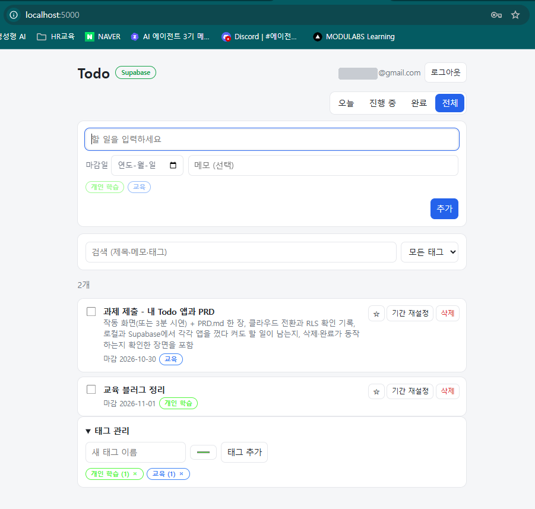
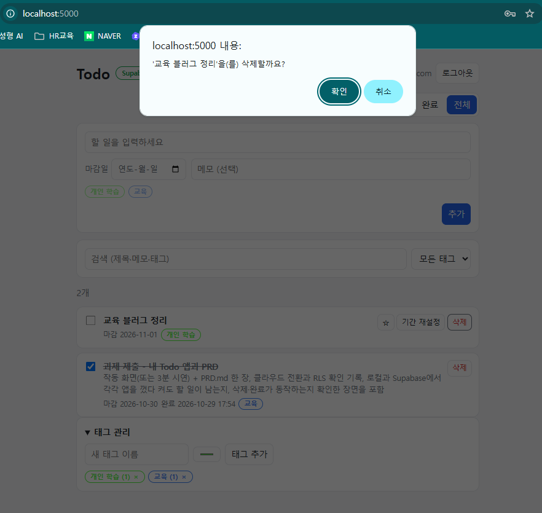
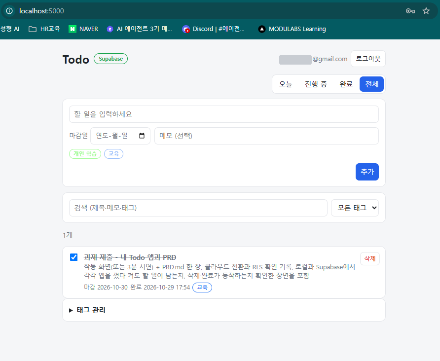
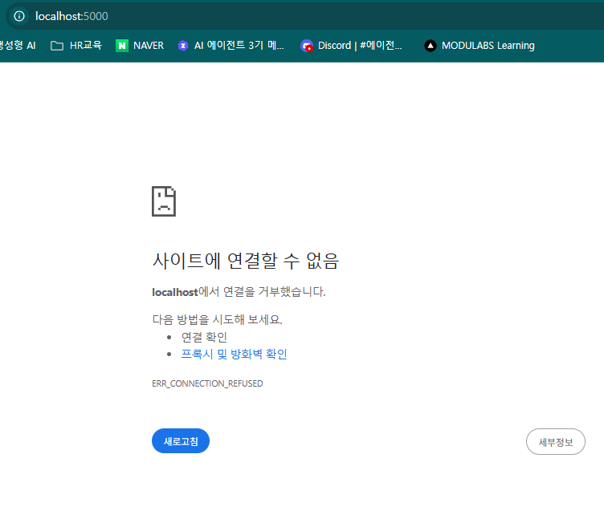
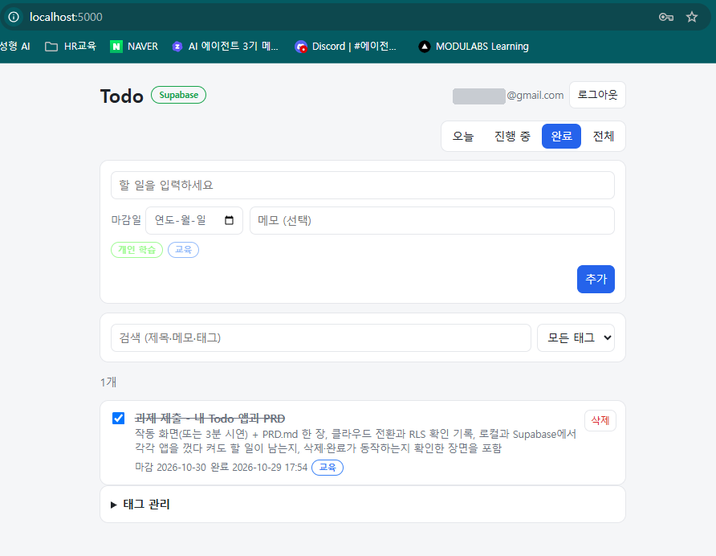
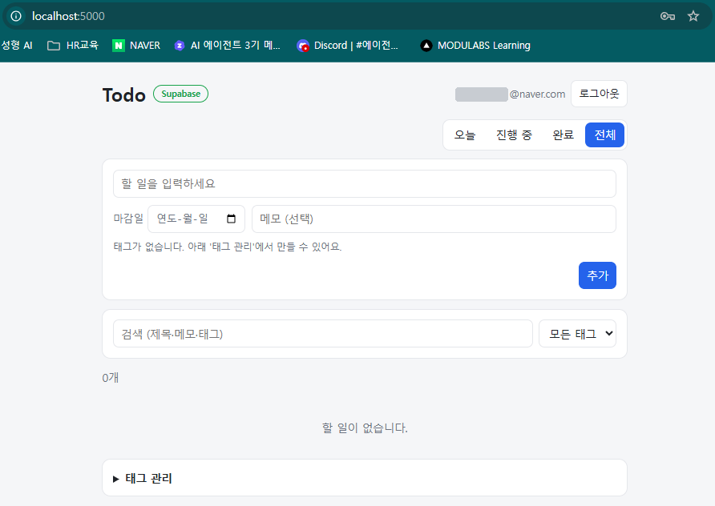

# 과제 제출: Todo 앱 (길 A → 길 B)

- 저장소: https://github.com/basco-git/aiffel-work/tree/main/todo
- PRD: [PRD.md](PRD.md)
- 배포: 하지 않음 (로컬 서버 `http://localhost:5000` + 클라우드 DB)

## 기록 (한 줄씩)

- **클라우드 전환**: 2026-10-29 `supabase/schema.sql`을 Supabase(서울 리전) SQL Editor에서 실행하고 `.env`의 `DB_BACKEND`를 `sqlite`→`supabase`로 바꿔, 화면·API 코드 수정 없이 같은 앱이 Supabase에 저장되는 것을 확인함 (B1–B3).
- **RLS 확인**: 2026-10-29 모든 표에 RLS(`user_id = auth.uid()`)를 켜고, 비로그인 읽기·쓰기 차단 2/2 통과(`check_rls.py`, 17:42), 다른 계정(B)으로 로그인하면 A의 할 일·태그가 0개로 보이는 것을 확인함 (B4).

## 확인 장면

### 길 A — 로컬 SQLite (`DB_BACKEND=sqlite`)

| # | 확인 | 결과 | 장면 |
|---|---|---|---|
| A1 | 할 일 목록 (시연용 3개 추가) | 4개 표시, 마감 지난 일 빨간색 |  |
| A2 | 완료 + 삭제 | `[시연] 보고서 초안 쓰기` 완료(취소선, 완료 시각 기록), `[시연] 장보기` 삭제 → 3개 |  |
| A3 | 앱 껐다 켜기 | 2026-10-29 17:04:35 서버 종료(접속 거부 확인) → 다시 켠 뒤 3개 그대로, 완료 상태 유지 |  |

### 길 B — Supabase (`DB_BACKEND=supabase`)

| # | 확인 | 결과 | 장면 |
|---|---|---|---|
| B1 | 계정 A로 로그인 후 할 일 목록 | `Supabase` 표시, 할 일 2개·태그 2개 |  |
| B2 | 완료 + 삭제 | `과제 제출` 완료(취소선, 완료 시각 17:54) → `교육 블로그 정리` 삭제 확인 → 전체 탭 1개만 남음 |   |
| B3 | 앱 껐다 켜기 | 서버 종료 → `localhost에서 연결을 거부했습니다` → 다시 켠 뒤 완료한 할 일·완료 시각 그대로 |   |
| B4 | 계정 B로 로그인 (RLS) | A의 할 일·태그가 하나도 안 보임 (0개) |  |

## 3분 시연 순서 (녹화용)

| 시간 | 화면 | 말할 것 |
|---|---|---|
| 0:00–0:20 | PRD.md | 무엇을 만들었는지: 로컬 Todo → Supabase 전환, 기본 CRUD + 마감일·태그·오늘·검색 |
| 0:20–1:00 | 길 A 앱 (`로컬 SQLite` 표시) | 추가 → 완료 → 삭제. `stop.bat` → 새로고침(접속 안 됨) → `start.bat` → 할 일 그대로 |
| 1:00–1:20 | `.env` (키 부분은 가리기) | `DB_BACKEND=supabase` 한 줄로 전환. 화면·API 코드는 그대로 |
| 1:20–2:10 | 길 B 앱 (`Supabase` 표시) | 로그인 → 추가 → 완료 → 삭제. 서버 껐다 켜기 → 그대로. Supabase 대시보드 Table Editor에 같은 행 |
| 2:10–2:50 | 다른 계정 로그인 + `check_rls.py` 결과 | B 계정에는 A의 할 일이 안 보임. 스크립트 결과 전부 PASS |
| 2:50–3:00 | 마무리 | 비밀값은 `.env`, service_role 키는 쓰지 않음, 로그인은 Supabase Auth |
