# 과제 제출: Todo 앱 (길 A → 길 B)

- 저장소: https://github.com/basco-git/aiffel-work/tree/main/todo
- PRD: [PRD.md](PRD.md)
- 배포: https://basco-todo.onrender.com (Render 무료 플랜, 길 B·Supabase. 15분 동안 접속이 없으면 잠들어 첫 접속이 30초~1분 걸림)

## 기록 (한 줄씩)

- **클라우드 전환**: 2026-10-29 `supabase/schema.sql`을 Supabase(서울 리전) SQL Editor에서 실행하고 `.env`의 `DB_BACKEND`를 `sqlite`→`supabase`로 바꿔, 화면·API 코드 수정 없이 같은 앱이 Supabase에 저장되는 것을 확인함 (B1–B3).
- **RLS 확인**: 2026-10-29 모든 표에 RLS(`user_id = auth.uid()`)를 켜고, 비로그인 읽기·쓰기 차단 2/2 통과(`check_rls.py`, 17:42), 다른 계정(B)으로 로그인하면 A의 할 일·태그가 0개로 보이는 것을 확인함 (B4).
- **터미널 명령·작업 규칙**: 2026-11-02 앱의 API를 그대로 부르는 `todo` 명령(`backend/cli.py`, `todo.bat`: add·list·done·summary, `--json`)과 AI 작업 규칙 `AGENTS.md`를 추가해, AI 도구도 웹 화면과 같은 입력 검사·로그인·RLS를 거쳐서만 데이터를 다루게 함 (C1, C2).
- **스킬**: 2026-11-02 `todo summary --json` 결과를 커밋 메시지 형식으로 정리하는 `todo-summary` 스킬을 만들고, `/todo-summary`로 실행되는 것을 확인함 (C3, C4).
- **MCP**: 2026-11-02 파일 MCP 서버 `todo-files`(`.mcp.json`)에 `docs`·`frontend`·`backend`만 열고, 다시 시작한 뒤 `.env`·`todo.db`가 있는 todo 폴더 접근이 `Access denied`로 막히는 것을 확인함 (C5).

## 확인 장면

### 길 A — 로컬 SQLite (`DB_BACKEND=sqlite`)

| # | 확인 | 결과 | 장면 |
|---|---|---|---|
| A1 | 할 일 목록 (시연용 3개 추가) | 4개 표시, 마감 지난 일 빨간색 | 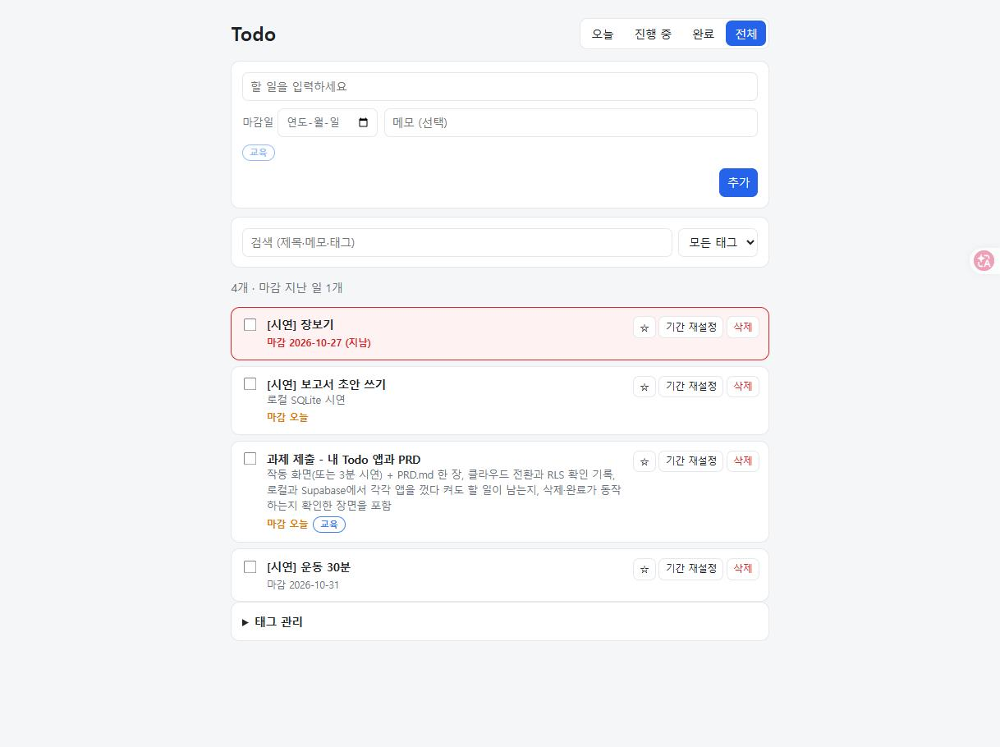 |
| A2 | 완료 + 삭제 | `[시연] 보고서 초안 쓰기` 완료(취소선, 완료 시각 기록), `[시연] 장보기` 삭제 → 3개 | 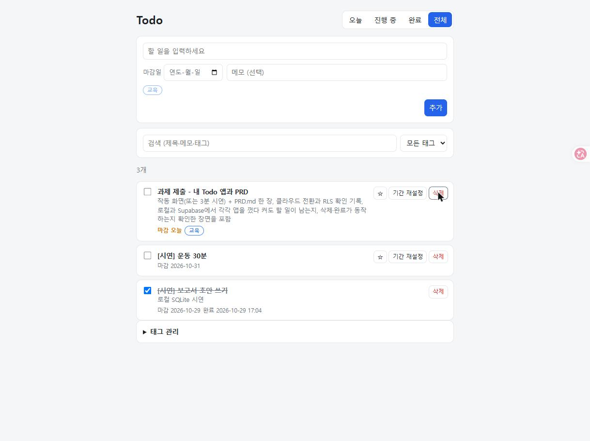 |
| A3 | 앱 껐다 켜기 | 2026-10-29 17:04:35 서버 종료(접속 거부 확인) → 다시 켠 뒤 3개 그대로, 완료 상태 유지 | 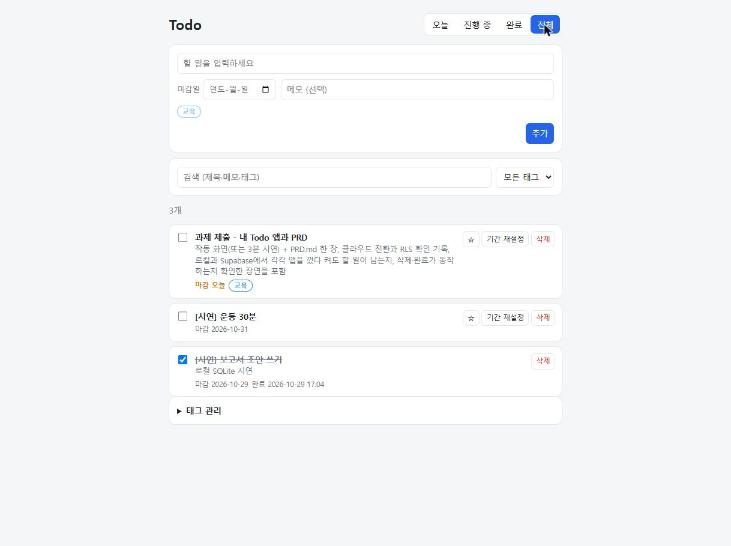 |

### 길 B — Supabase (`DB_BACKEND=supabase`)

| # | 확인 | 결과 | 장면 |
|---|---|---|---|
| B1 | 계정 A로 로그인 후 할 일 목록 | `Supabase` 표시, 할 일 2개·태그 2개 | 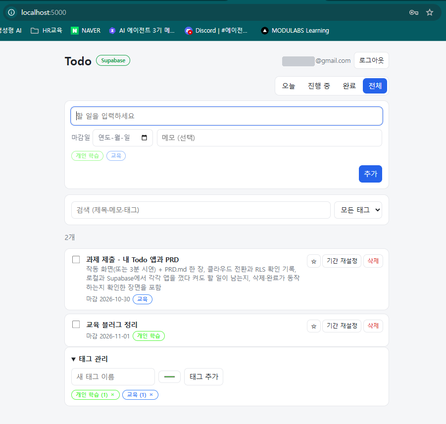 |
| B2 | 완료 + 삭제 | `과제 제출` 완료(취소선, 완료 시각 17:54) → `교육 블로그 정리` 삭제 확인 → 전체 탭 1개만 남음 | 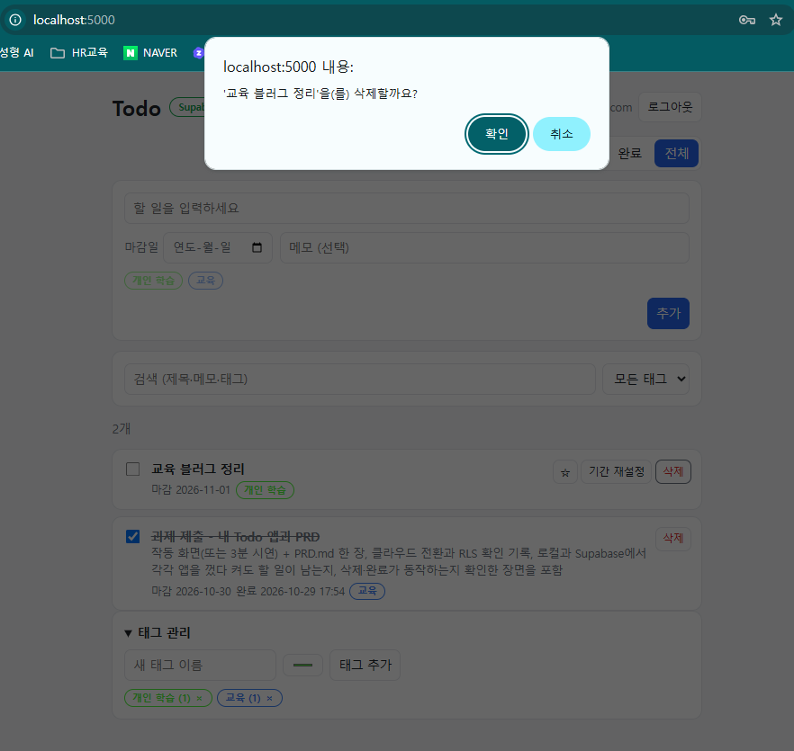 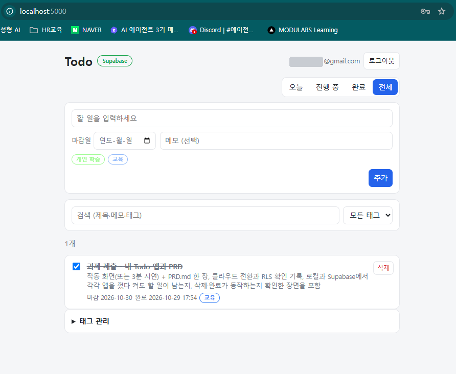 |
| B3 | 앱 껐다 켜기 | 서버 종료 → `localhost에서 연결을 거부했습니다` → 다시 켠 뒤 완료한 할 일·완료 시각 그대로 | 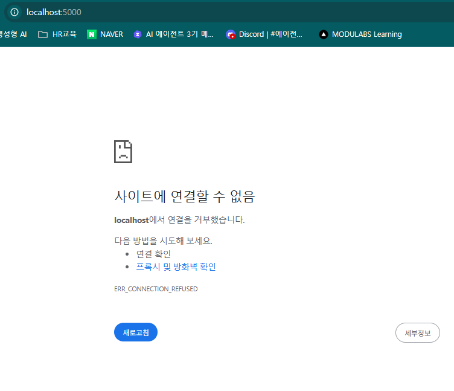 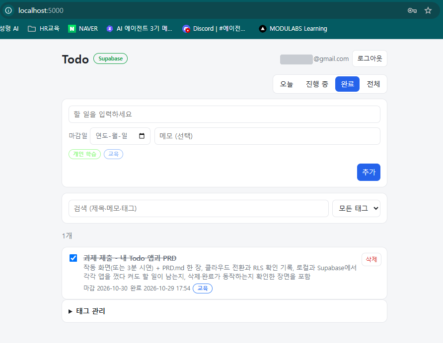 |
| B4 | 계정 B로 로그인 (RLS) | A의 할 일·태그가 하나도 안 보임 (0개) | 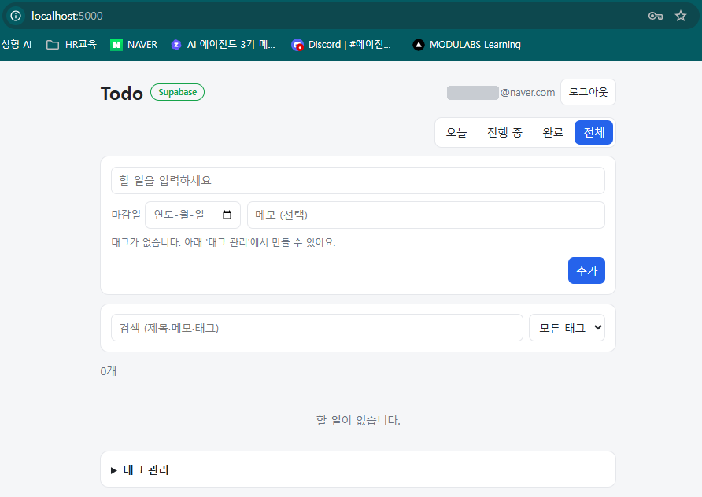 |

### 길 C — AI 도구 연동 (CLI · 스킬 · MCP)

C3·C4·C5는 실제 실행 결과를 HTML로 다시 그린 화면이다(문구·값은 실행 결과 그대로).

| # | 확인 | 결과 | 장면 |
|---|---|---|---|
| C1 | 터미널 명령 `todo` | `.\todo.bat list --today` → 오늘 할 일 2건(#11, #9)이 마감일과 함께 표시됨 | 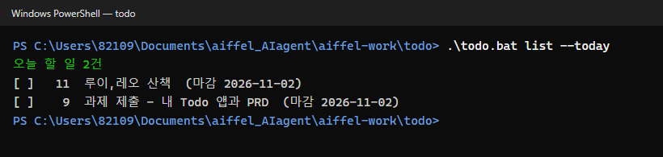 |
| C2 | 삭제 전 승인 (`AGENTS.md` 규칙) | 파일 지우기를 요청하자 AI가 경로·크기·내용·git 추적 여부를 먼저 보여 주고 확인받은 뒤 그 파일 하나만 삭제 | 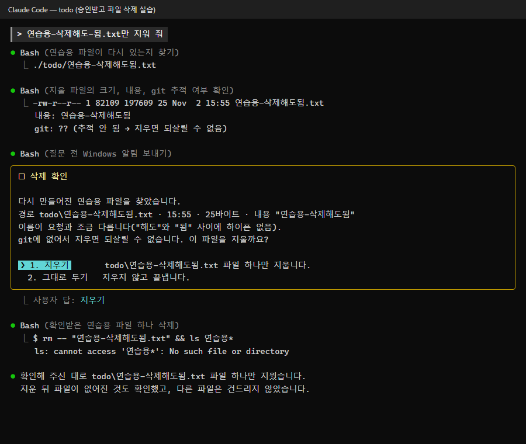 |
| C3 | 스킬 등록 | `.claude/skills/todo-summary/SKILL.md` 생성 → Claude Code에서 `/todo` 입력 시 `/todo-summary`가 목록에 나옴 | 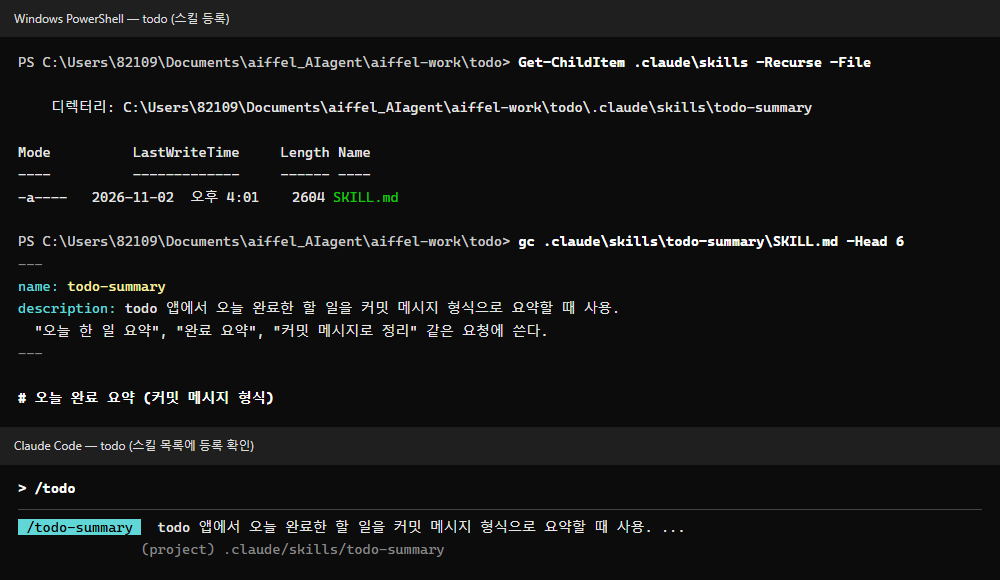 |
| C4 | 스킬 실행 | `/todo-summary` → `todo summary --json` 결과로 오늘 완료 0건·남은 일 2건을 정리하고, 완료 처리는 확인 후 실행한다고 안내 | 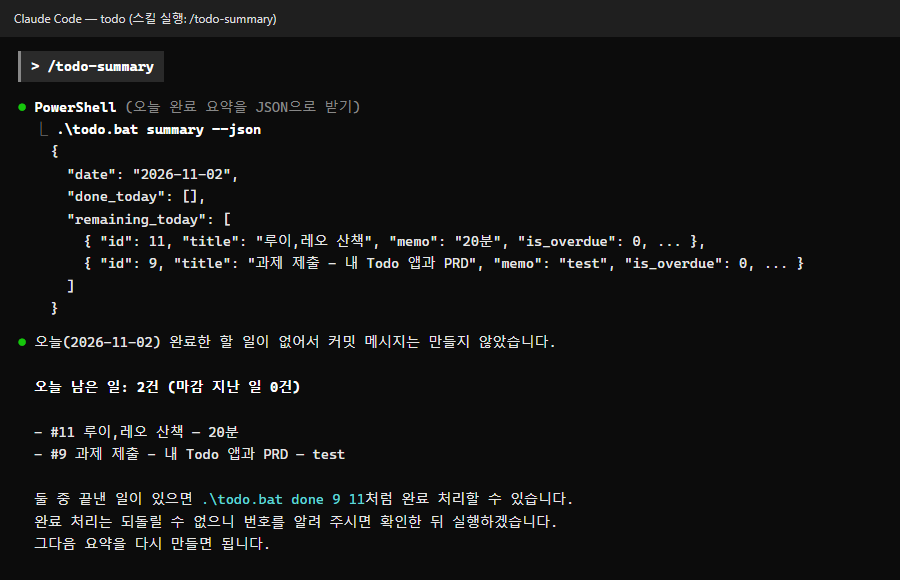 |
| C5 | MCP 서버 `todo-files` 연결 | 2026-11-02 다시 시작 후 연결 확인: 허용 폴더는 `docs`·`frontend`·`backend` 3개뿐이고, `.env`·`todo.db`가 있는 todo 폴더는 `Access denied`로 막힘 | 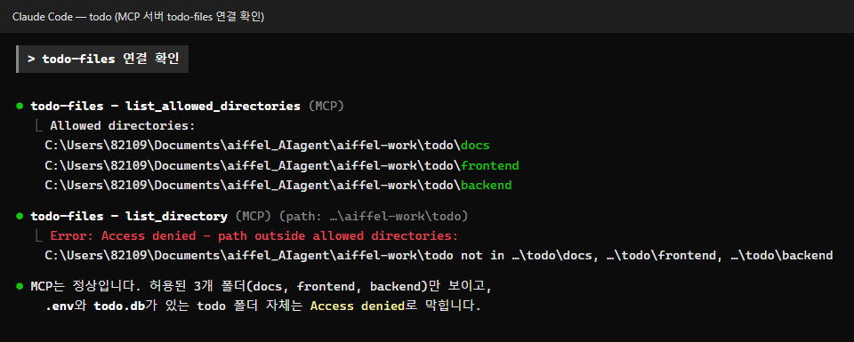 |

## 3분 시연 순서 (녹화용)

| 시간 | 화면 | 말할 것 |
|---|---|---|
| 0:00–0:15 | PRD.md | 무엇을 만들었는지: 로컬 Todo → Supabase 전환 → AI 도구 연동, 기본 CRUD + 마감일·태그·오늘·검색 |
| 0:15–0:45 | 길 A 앱 (`로컬 SQLite` 표시) | 추가 → 완료 → 삭제. `stop.bat` → 새로고침(접속 안 됨) → `start.bat` → 할 일 그대로 |
| 0:45–1:00 | `.env` (키 부분은 가리기) | `DB_BACKEND=supabase` 한 줄로 전환. 화면·API 코드는 그대로 |
| 1:00–1:40 | 길 B 앱 (`Supabase` 표시) | 로그인 → 추가 → 완료 → 삭제. 서버 껐다 켜기 → 그대로. Supabase 대시보드 Table Editor에 같은 행 |
| 1:40–2:10 | 다른 계정 로그인 + `check_rls.py` 결과 | B 계정에는 A의 할 일이 안 보임. 스크립트 결과 전부 PASS |
| 2:10–2:50 | 터미널 + Claude Code | `.\todo.bat list --today` → `/todo-summary`로 오늘 요약 → MCP `todo-files`는 docs·frontend·backend만 보이고 todo 폴더는 막힘. AI도 앱 API·RLS를 거쳐서만 데이터를 다룸 (`AGENTS.md`) |
| 2:50–3:00 | 마무리 | 비밀값은 `.env`, service_role 키는 쓰지 않음, 로그인은 Supabase Auth, AI 도구에는 `.env`·`todo.db`를 열지 않음 |
