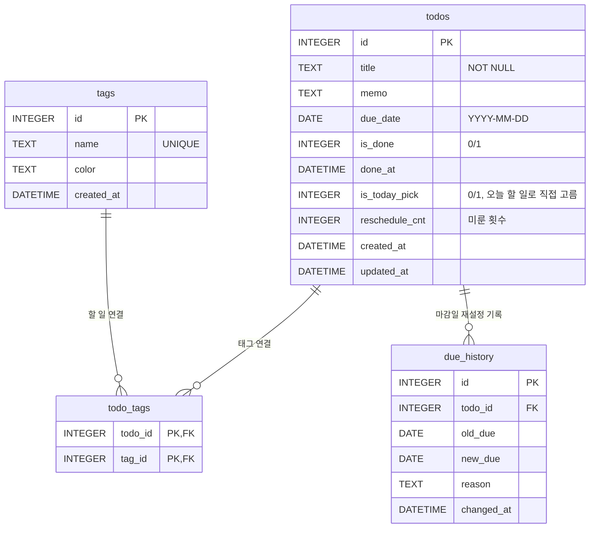

# Todo 앱 DB 구조도 (SQLite)

실제 스키마: [`../db/schema.sql`](../db/schema.sql)

## ERD

## 관계

- `todos` 1 : N `due_history` — 할 일 하나의 마감일을 여러 번 바꿀 수 있다.
- `todos` N : M `tags` — `todo_tags` 연결 표로 잇는다.
- 할 일을 삭제하면 태그 연결과 재설정 기록도 함께 삭제된다(`ON DELETE CASCADE`). 태그 자체는 남는다.

## 날짜 형식

SQLite에는 전용 날짜 타입이 없어서, 열을 `DATE` / `DATETIME`으로 선언하고 `CHECK`로 형식을 강제한다.

| 형식 | 예 | 검사 |
|---|---|---|
| `DATE` | `2026-10-29` | `date(x) IS x` |
| `DATETIME` | `2026-10-29 16:30:00` | `datetime(x) IS x` |

`2026/10/29`, `2026-02-30` 같은 잘못된 값은 저장되지 않는다. 이 형식은 글자 순서대로 정렬해도 날짜 순서와 같아서 비교·정렬이 그대로 된다.

## PRD 기능 매핑

| 기능 | 처리 |
|---|---|
| 추가 / 목록 / 삭제 | `todos` INSERT / SELECT / DELETE |
| 완료 표시 | `is_done = 1`, `done_at` 기록 |
| 미수행 시 기간 재설정 | `due_date` UPDATE → 트리거가 `due_history` 기록 + `reschedule_cnt` 증가 |
| 마감일 표시 | `due_date` |
| 카테고리(태그) | `tags` + `todo_tags` |
| 오늘의 할 일 | 뷰 `v_today`: 미완료 중 마감이 오늘/지남이거나 `is_today_pick = 1` (`is_overdue`로 지난 일 구분) |
| 검색 | `title`, `memo`, 태그 `name`에 `LIKE '%검색어%'` |

## 확장 메모

- 로그인 추가 시: `users` 표를 만들고 `todos`, `tags`에 `user_id` FK 추가. 인증은 검증된 라이브러리 사용.
- 할 일이 수천 개 이상이면 검색을 SQLite FTS5 `trigram` 토크나이저로 교체(한글 부분 검색 가능).
