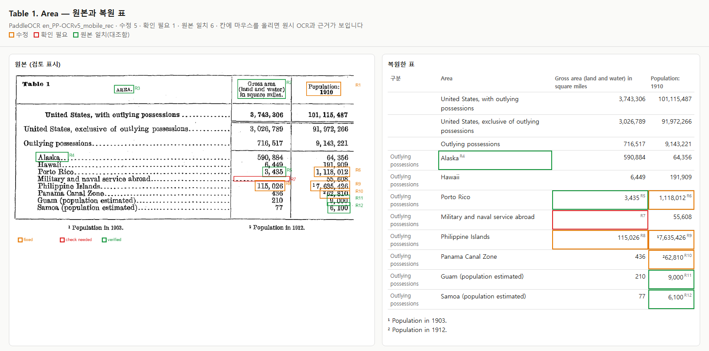
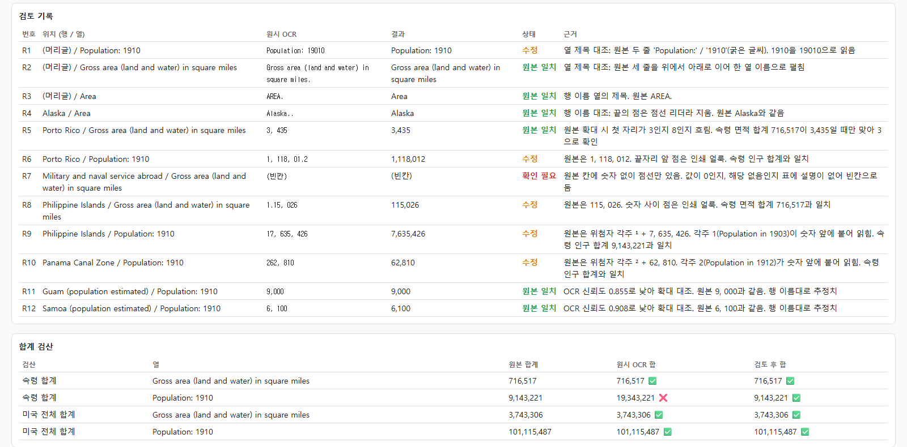

# yolo-ocr

아이펠 선택 과제 **B. OCR 표 이미지 문서화** 제출 폴더입니다.
Census **Table 1** 표 이미지를 PaddleOCR(영어 모델)로 읽었습니다. 행 이름과 열 제목을 연결한 `table.csv`와 `document.md`를 만들고,
원본과 대조한 수정 내역과 "확인 필요" 칸을 원본 위치와 함께 남겼습니다.

같은 폴더에 먼저 만든 범용 OCR 웹 서비스(`web/`, `ocr-service/`)와 웹캠 YOLO 예제(`webcam_yolo.py`)도 있습니다(아래 [OCR 웹 서비스](#ocr-웹-서비스-참고) 참고).

## 과제 B 결과 한눈에

| 결과물 | 위치 |
| --- | --- |
| 원본과 복원 표를 나란히 보는 화면 | [공개 화면](https://basco-git.github.io/aiffel-work/yolo-ocr/table1/viewer.html) · [outputs/viewer.html](outputs/viewer.html) |
| 복원 문서 (제목·출처·페이지, 복원 표, 검토 기록, 확인 필요, 합계 검산) | [outputs/document.md](outputs/document.md) |
| 행·열이 연결된 표 | [outputs/table.csv](outputs/table.csv) |
| 실행 기록 (출처, 입력, 모델·패키지 버전, 실행 위치, 설정) | [outputs/manifest.json](outputs/manifest.json) |
| 입력 사본, 원시 OCR JSON, 텍스트·좌표, 영역 시각화 | [outputs/ocr/](outputs/ocr/) |
| 처리 코드 / 설정·검토 기록 | [ocr_table.py](ocr_table.py) / [review/census-table1.json](review/census-table1.json) |

| 원본과 복원 표 (검토 표시) | 검토 기록과 합계 검산 |
| --- | --- |
|  |  |

OCR 영역 번호 그림: [outputs/ocr/ocr_boxes.png](outputs/ocr/ocr_boxes.png) (파랑: 신뢰도 0.95 이상, 빨강: 미만)

## 실행 방법

실행 위치는 **로컬 PC(Windows 11, CPU만 사용, GPU 없음)** 입니다. Python 3.12 가상환경에서 실행했습니다.

```powershell
cd yolo-ocr
uv venv --python 3.12 .venv                       # 또는 python3.12 -m venv .venv
uv pip install --python .venv\Scripts\python.exe -r requirements.txt
.venv\Scripts\python ocr_table.py                 # OCR부터 실행 (CPU 약 45~65초)
.venv\Scripts\python ocr_table.py --reuse         # 저장된 원시 OCR로 표·문서만 다시 생성
```

- 처음 실행할 때 PaddleOCR이 모델(`PP-OCRv5_server_det`, `en_PP-OCRv5_mobile_rec`)을 `~/.paddlex/official_models`에 내려받습니다.
- 원본 대조 결과는 `review/census-table1.json`의 `corrections`에 적습니다. OCR을 다시 돌려 원시값이 기록과 달라지면, 그 칸은 자동으로 "확인 필요"로 바뀌고 경고가 남습니다.
- 같은 명령을 두 번 실행해 `table.csv`가 똑같이 나오는 것을 확인했습니다.

## 도구와 설정을 고른 이유

| 선택 | 이유와 실제 결과 |
| --- | --- |
| PaddleOCR 3.7.0 + paddlepaddle 3.3.1 | 과제가 지정한 도구입니다. 줄 단위로 글자와 좌표(`rec_boxes`)를 함께 주므로, 좌표로 행·열을 연결할 수 있습니다. |
| 영어 전용 인식 모델 `en_PP-OCRv5_mobile_rec` | 과제가 "영어 인식 모델"을 요구했습니다. PaddleOCR 3.7은 `lang="en"`만 주면 다국어 모델(PP-OCRv6)을 골라서, 모델 이름을 직접 지정했습니다. 다국어 모델로 시험해 보니 이 표에서는 오류가 더 적었습니다(제목, 1910, 숫자 안의 점을 맞게 읽음). 하지만 각주 붙음 오류는 두 모델 모두 같았습니다. |
| Python 3.12 가상환경 | PC 기본 Python 3.15에는 paddlepaddle 휠이 없습니다. `uv`로 3.12 환경을 따로 만들었습니다. |
| `enable_mkldnn=False` | 기본값(oneDNN 켬)으로는 Windows CPU에서 `NotImplementedError: ConvertPirAttribute2RuntimeAttribute not support` 오류가 나서 껐습니다. |
| 문서 방향 보정·왜곡 보정·줄 방향 분류 끔 | 입력이 똑바로 스캔된 표 한 장이라 필요 없고, 끄면 단계가 줄어듭니다. |
| 열은 괘선 x 범위, 행은 세로 중심 | 원본에 세로 괘선이 2개 있어 열 경계를 정하기 쉽습니다. 값은 같은 높이의 행 이름에 붙였고, 어느 행에도 붙지 않은 줄은 0개였습니다. |
| 합계 검산 | 이 표에는 합계 행이 있습니다. 부분값의 합으로 고친 값이 맞는지 원본 밖의 근거로 한 번 더 확인했습니다. |

## 원본 대조에서 발견한 오류

숫자, 행 이름, 열 제목을 하나 이상씩 골라 원본을 확대해 대조했습니다. 전체 기록(R1~R12)은 [document.md의 검토 기록](outputs/document.md#검토-기록)에 있습니다.

| 원시 OCR | 원본 | 오류 종류 |
| --- | --- | --- |
| `17, 635, 426` (Philippine Islands / 인구) | ¹7,635,426 | 위첨자 각주 ¹이 숫자 앞에 붙음. 신뢰도 0.960으로 높았음 |
| `262, 810` (Panama Canal Zone / 인구) | ²62,810 | 위첨자 각주 ²가 숫자 앞에 붙음. 신뢰도 0.964 |
| `1.15, 026`, `1, 118, 01.2` | 115,026 / 1,118,012 | 인쇄 얼룩을 점으로 읽음 |
| `Population: 19010` (열 제목) | Population: 1910 | 굵은 글씨 숫자를 잘못 읽음 |
| `Table l`, `Population in 1012.` | Table 1 / 1912 | 숫자 1을 영문 l로 읽음, 9를 0으로 읽음 |

- 원시값으로 속령 인구를 더하면 19,343,221이 되어 원본 합계 9,143,221과 맞지 않습니다. 고친 뒤에는 합계 검산 4개가 모두 맞습니다.
- 천 단위 쉼표 뒤 공백(`3, 743, 306`)은 오래된 인쇄 방식이라 OCR이 그대로 읽었습니다. CSV에서는 쉼표와 공백을 지우고 숫자만 저장했습니다.

## "확인 필요"로 남긴 부분

- **Military and naval service abroad / Gross area** 칸: 원본에 숫자 없이 점선만 있습니다. 0인지 "해당 없음"인지 표에 설명이 없어 추측하지 않고 빈칸으로 두었습니다.
- 확인 필요는 아니지만 짚어 둔 것이 있습니다. 'Population: 1910' 열에서 Philippine Islands는 1903년, Panama Canal Zone은 1912년 값입니다(원본 각주). Guam과 Samoa 인구는 원본에 적힌 대로 추정치입니다. CSV의 `note` 열에 남겼습니다.

## 처음 예상한 오류와 실제 결과

- 예상: 과제 예시처럼 0↔O 혼동, 두 행이 한 줄로 붙는 오류, 천 단위 쉼표 때문에 열이 갈라지는 오류를 예상했습니다.
- 실제: 0↔O 혼동과 행 붙음은 없었습니다. 열이 갈라지는 문제도 좌표로 열을 정하니 생기지 않았습니다. 대신 예상하지 못한 **각주 위첨자가 숫자에 붙는 오류**가 가장 위험했습니다. 신뢰도가 0.96으로 높아서 "신뢰도가 낮은 칸만 보면 된다"는 방식으로는 잡히지 않았고, 합계 검산과 원본 확대로 찾았습니다.
- 반대로 신뢰도가 낮았던 칸(Guam 0.855, Samoa 0.908)은 실제로는 맞게 읽혀 있었습니다.

## 처리 범위

- 처리함: `input/census-table.png`의 Table 1 전체, 11행 × 값 열 2개 = 22칸
- 처리하지 않음: `input/fraser-table.png`(FRASER No. 11). 과제는 표 하나를 고르는 것이라 범위에서 뺐습니다.

## 입력 자료의 출처와 공유 조건

| 파일 | 출처 | 공유 조건 |
| --- | --- | --- |
| `input/census-table.png` (= `ocr-test2.png`) | 미국 인구조사국 [1910 인구조사 보고서 Volume 1 (1913년 발행)](https://www2.census.gov/library/publications/decennial/1910/volume-1/volume-1-p3.pdf), PDF 2쪽 · 인쇄 22쪽, Table 1 | 미국 연방정부 발행 퍼블릭 도메인 자료 |
| `input/fraser-table.png` (= `ocr-test.png`) | FRASER [1935 연방준비제도 연차보고서 (1936년 발행)](https://fraser.stlouisfed.org/files/docs/publications/arfr/1930s/arfr_1935.pdf), PDF 98쪽 · 인쇄 91쪽, No. 11 | 미국 연방정부 발행 퍼블릭 도메인 자료 |

두 이미지는 아이펠 13번 교안(AI가 이미지를 읽기까지) 과제 B에서 제공한 것입니다(원문에서 표 부분만 200 dpi로 추출). 출처와 공유 조건은 교안의 출처 표기를 따랐습니다.

개인정보나 회사 기밀이 담긴 파일은 쓰지 않았습니다.

## 폴더 구성

| 경로 | 내용 |
| --- | --- |
| `ocr_table.py` | 과제 B 처리 코드: OCR → 행·열 연결 → 검토 적용 → CSV·문서·표시 그림·manifest |
| `review/census-table1.json` | 처리 설정(모델, 열 x 범위)과 원본 대조 기록 |
| `requirements.txt` | 과제 B 실행 패키지 버전 |
| `input/` | 과제 입력 표 이미지 2장 |
| `outputs/` | 과제 B 결과물 (위 표 참고) |
| `docs/screenshots/` | 제출용 화면 캡처 |
| `web/`, `ocr-service/` | OCR 웹 서비스 (tesseract.js) |
| `webcam_yolo.py`, `yolo-test.jpg` | 웹캠 YOLO(ultralytics) 객체 탐지 예제 |
| `ocr-test.png`, `ocr-test2.png` | 웹 서비스 샘플 이미지 (`input/`의 두 표와 같은 파일) |
| `yolo11n.pt` | YOLO 모델 가중치 (git 제외, ultralytics가 자동 다운로드) |

## OCR 웹 서비스 (참고)

과제 B 전에 만든 범용 OCR 웹 서비스입니다. tesseract.js를 써서 여러 장을 한 번에 인식하고 표를 CSV로 뽑습니다.
원본 대조 기록과 확인 필요 표시는 없어서, 과제 B 제출물은 위의 `ocr_table.py` 결과입니다.

| 구분 | 주소 | 설명 |
| --- | --- | --- |
| 공개(웹) | <https://basco-git.github.io/aiffel-work/yolo-ocr/> | 설치 없이 접속. OCR이 브라우저에서 실행되고 결과는 이 브라우저에 저장 |
| 내 PC | `cd yolo-ocr/ocr-service` → `npm install` → `npm start` | <http://localhost:3000> 서버 버전. 결과가 `outputs/`에 `.txt` · `.json` · `.csv`로 저장 |

- 드래그 & 드롭 / 클릭 / `Ctrl+V` 붙여넣기로 이미지 추가, 여러 장(최대 20장) 일괄 인식
- 표 자동 추출 → CSV: 이미지 괘선 + 단어 좌표로 행·열 복원
- 자동 보정(흑백·2배 확대·대비·샤프닝), 언어·페이지 모드 선택
- 서버 버전 사용법·API는 [ocr-service/README.md](ocr-service/README.md)

## yolo-ocr 진행 과정

목표: 스캔한 표 이미지를 올리면 글자와 표 구조를 뽑아 파일로 저장하는 웹 서비스를 만든다.

| 순서 | 한 일 | 결과 |
| --- | --- | --- |
| 1 | Python 환경 확인 후 스택 결정 | Python 3.15에는 OCR 라이브러리가 없었고 휠 호환도 장담할 수 없어 Node + tesseract.js 선택 |
| 2 | Express 서버·업로드·저장 API와 화면 구현 | 업로드 → 인식 → `outputs/*.txt` · `*.json` 저장 |
| 3 | `ocr-test.png`로 첫 인식 | 신뢰도 59%, 3,883자. 숫자는 대체로 읽히지만 열 정렬은 흐트러짐 |
| 4 | sharp 자동 보정(흑백 · 2배 확대 · 정규화 · 샤프닝) 추가 | 신뢰도 66%(+7%p), 4,561자 |
| 5 | 드래그 & 드롭 오류 수정 | 원인은 드롭 영역을 덮던 투명 `<input type=file>`. 오버레이 제거 + 전역 드롭 차단 + `Ctrl+V` |
| 6 | 여러 장 일괄 처리 | 최대 20장 순차 처리, 파일별 상태·`열기`·`CSV` 목록 |
| 7 | 표 → CSV 추출(`table.js`) | 세로 괘선 8개 + 단어 좌표로 **54행 × 8열**, `61, 744` → `61,744` 정리 |
| 8 | Chrome 헤드리스 E2E 확인 | 드롭 → 1장 OCR → CSV 패널 → 2장 일괄까지 통과, 콘솔 에러 0건 |
| 9 | GitHub Pages 정적 버전(`web/`) 추가 | tesseract.js를 브라우저에서 실행, 기록은 `localStorage`. 같은 이미지로 54행 × 8열 · 신뢰도 67% 확인 |
| 10 | 배포 워크플로와 README 정리 | Actions가 웹 버전을 Pages로 복사, 맨 위 README 표에 등록 |

## 과제 B 보완 진행 과정

목표: 과제 B 기준(PaddleOCR, 원본 대조 기록, 확인 필요, manifest)에 맞게 Census Table 1 하나를 원본으로 되돌아갈 수 있는 표로 만든다.

| 순서 | 한 일 | 결과 |
| --- | --- | --- |
| 1 | 과제 기준과 기존 웹 서비스 비교 | PaddleOCR 미사용, `document.md`·`manifest.json`·검토 기록·확인 필요 표시 없음, 결과 파일이 git 제외였음 |
| 2 | 폴더 이름 정리 | `yolo-cor` → `yolo-ocr`, 맨 위 README·배포 워크플로 경로 함께 변경 |
| 3 | `uv`로 Python 3.12 환경 + PaddleOCR 설치 | paddlepaddle 3.3.1, paddleocr 3.7.0 설치(약 1분) |
| 4 | 첫 실행 오류 해결 | oneDNN `NotImplementedError` → `enable_mkldnn=False` |
| 5 | 모델 비교 | `lang="en"`은 다국어 PP-OCRv6을 고름 → 과제대로 영어 전용 `en_PP-OCRv5_mobile_rec` 지정 |
| 6 | `ocr_table.py` 작성 | OCR 줄 41개 → 11행 × 3열, 미배정 0개 |
| 7 | 원본 확대 대조 후 `review/census-table1.json` 기록 | 수정 5, 확인 필요 1, 원본 일치 6 (R1~R12) |
| 8 | 합계 검산 추가 | 원시값은 속령 인구 합계 불일치(19,343,221) → 고친 뒤 4/4 일치 |
| 9 | 검토 화면·캡처 | `viewer.html`, 캡처 2장, Pages `/yolo-ocr/table1/`에 배포 |
| 10 | 재실행 확인 | OCR부터 다시 돌려 `table.csv` 동일 확인 |

## 회고 (yolo-ocr)

- 처음에는 파이썬으로 만들려 했지만 현재 파이썬(3.15)에 OCR 라이브러리가 없었고, 새 버전이라 휠이 나왔는지 확신할 수 없어 Node + tesseract.js로 바꿨음. 언어를 맞추는 것보다 "지금 실행되는 것"을 먼저 확인한 판단이었음.
- OCR은 붙이면 끝이 아니었음. 첫 결과가 신뢰도 59%로 숫자 사이에 점선이 섞여 나와서, 흑백·2배 확대·정규화·샤프닝 보정을 넣어 66%까지 올렸음. 그래도 오른쪽 흐린 열의 숫자는 일부 깨짐.
- 드래그 & 드롭이 안 되던 원인은 CSS가 아니라 투명한 `<input type=file>`이 드롭 영역 전체를 덮고 있었기 때문이었음. 화면만 보고는 알기 어려운 종류의 버그라, 입력 요소를 화면 밖으로 빼고 클릭을 JS로 처리하는 쪽으로 구조를 바꿨음.
- 고친 뒤 실제 마우스로 끌어 보지는 못했고, 헤드리스 Chrome에서 `DragEvent`를 만들어 확인했음. 사용자 환경에서 한 번 더 끌어 보는 확인이 남아 있음.
- 표 CSV 1차 결과에는 셀 양 끝에 `|`, `[` 같은 괘선 조각과 점선 리더가 그대로 들어왔음. 표 구조를 살리는 것과 셀을 깨끗하게 만드는 것을 따로 손봐야 했음.
- `Maturity`처럼 여러 열에 걸친 머리글은 CSV 한 열에만 들어감. CSV에는 병합 개념이 없어서 구조적으로 해결하기 어렵고, 지금은 한계로 남겨 둠.
- 한 장에 20~40초가 걸려서 여러 장을 넣으면 오래 기다려야 함. 지금은 순서대로 처리하고 진행률만 보여주는데, 다음에는 취소 버튼이나 미리보기 축소로 시간을 줄이는 방법을 시도해 볼 만함.
- 공개 링크를 만들려고 서버를 배포하는 대신 브라우저에서 도는 정적 버전을 따로 만들었음. 그만큼 `outputs/` 파일 저장과 브라우저 저장이라는 두 가지 방식이 생겼고, OCR·표 추출 코드도 서버판과 웹판에 한 번씩 존재하게 되어 중복이 늘었음. 다음에는 공용 모듈로 합치는 편이 나을 것 같음.
- 웹 버전은 첫 인식 때 언어 데이터를 내려받아 30초 안팎이 걸림. 이후에는 브라우저 캐시를 써서 빨라지지만, 처음 쓰는 사람에게는 느리게 느껴질 수 있음.
- 테스트로 만든 결과 파일이 `outputs/`에 쌓여서, 커밋 전에 저장 폴더와 언어 데이터 캐시(`.tessdata/`), `node_modules/`를 `.gitignore`로 정리했음.
- 웹 서비스를 먼저 만들고 나서 과제 기준과 대 보니, 기능은 많아도 과제가 묻는 "원본으로 돌아갈 수 있는 근거"는 없었음. 결과물보다 평가 기준을 먼저 읽고 시작했어야 했음.
- Python 3.15 문제는 언어를 바꾸지 않아도 `uv`로 3.12 가상환경을 따로 만들면 풀렸음. 처음 판단 때 이 방법을 먼저 확인했으면 도구를 두 번 만들지 않았을 것임.
- 가장 위험한 오류(각주가 숫자에 붙음)는 신뢰도가 0.96으로 높았음. 신뢰도만 보고 검토 대상을 고르면 놓치는 오류라, 표 안의 합계 행으로 검산하는 것이 원본 대조의 근거로 효과가 컸음.
- 원본 대조 기록을 코드 안이 아니라 `review/*.json`에 두고, OCR을 다시 돌려 원시값이 달라지면 자동으로 "확인 필요"로 되돌리게 했음. 사람이 확인한 값이 다른 실행 결과에 조용히 덮어씌워지는 일을 막으려는 것임.
- 원문 문헌 이름과 페이지는 이미지만으로는 알 수 없어 처음에 "확인 필요"로 두었음. 13번 교안의 출처 표기에서 찾아 `review/census-table1.json`에 채우고 `--reuse`로 문서를 다시 만들었음.
