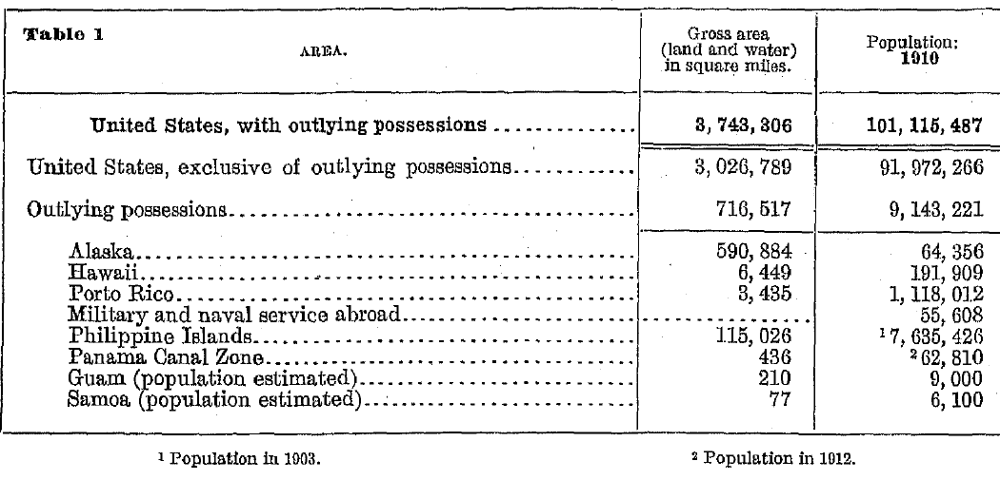
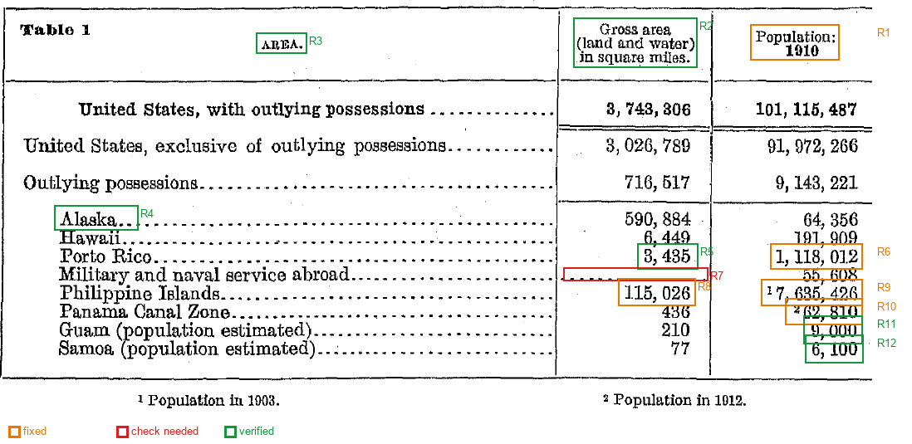

# Table 1. Area — OCR 복원 문서

| 항목 | 내용 |
|---|---|
| 표 제목 | Table 1. Area (원시 OCR: `Table l`) |
| 출처 | 미국 인구조사국(U.S. Census Bureau). 아이펠 13번 교안 과제 B에서 제공한 표 이미지(원문에서 표 부분만 200 dpi로 추출) |
| 원문 문헌 | 1910 인구조사 보고서 Volume 1 (1913년 발행) |
| 원문 페이지 | PDF 2쪽 · 인쇄 22쪽 |
| 원문 링크 | <https://www2.census.gov/library/publications/decennial/1910/volume-1/volume-1-p3.pdf> |
| 공유 조건 | 미국 연방정부 발행 퍼블릭 도메인 자료 (13번 교안 출처 표기 기준) |
| 입력 파일 | `input/census-table.png` (사본: `ocr/census-table.png`) |
| OCR | PaddleOCR 3.7.0, 검출 `PP-OCRv5_server_det`, 인식 `en_PP-OCRv5_mobile_rec` (영어) |
| 실행 | 로컬 PC (Windows 11, CPU, GPU 없음), 2026-11-10T17:18:46+09:00 |

## 원본과 검토 표시

| 원본 | 검토 표시 (주황 수정 · 빨강 확인 필요 · 초록 원본 일치) |
|---|---|
|  |  |

원본과 복원 표를 나란히 보려면 [viewer.html](viewer.html)을 엽니다. OCR 영역 번호는 [ocr/ocr_boxes.png](ocr/ocr_boxes.png), 좌표는 [ocr/ocr_lines.csv](ocr/ocr_lines.csv)에 있습니다.

## 복원한 표

숫자는 원본처럼 천 단위 쉼표를 붙여 표시합니다. [table.csv](table.csv)에는 쉼표 없이 저장했습니다. `¹`·`²`는 원본 각주이고, 빈칸은 원본에 값이 없는 칸입니다. 표시 옆 번호는 아래 검토 기록 번호입니다.

| 구분 | Area | Gross area (land and water) in square miles | Population: 1910 |
|---|---|---:|---:|
| - | United States, with outlying possessions | 3,743,306 | 101,115,487 |
| - | United States, exclusive of outlying possessions | 3,026,789 | 91,972,266 |
| - | Outlying possessions | 716,517 | 9,143,221 |
| Outlying possessions | Alaska | 590,884 | 64,356 |
| Outlying possessions | Hawaii | 6,449 | 191,909 |
| Outlying possessions | Porto Rico | 3,435 | 1,118,012 (수정 R6) |
| Outlying possessions | Military and naval service abroad | (확인 필요 R7) | 55,608 |
| Outlying possessions | Philippine Islands | 115,026 (수정 R8) | ¹7,635,426 (수정 R9) |
| Outlying possessions | Panama Canal Zone | 436 | ²62,810 (수정 R10) |
| Outlying possessions | Guam (population estimated) | 210 | 9,000 |
| Outlying possessions | Samoa (population estimated) | 77 | 6,100 |

- ¹ Population in 1903.
- ² Population in 1912.

## 검토 기록

숫자는 왼쪽 행 이름과 위쪽 열 제목을 함께 짚어 원본을 확대해 대조했습니다. '영역 번호'는 `ocr/ocr_boxes.png`·`ocr/ocr_lines.csv`의 번호입니다.

| 번호 | 위치 (행 / 열) | 영역 번호 | 원시 OCR | 결과 | 상태 | 근거 |
|---|---|---|---|---|---|---|
| R1 | (머리글) / Population: 1910 | 3, 7 | `Population: 19010` | Population: 1910 | **수정** | 열 제목 대조: 원본 두 줄 'Population:' / '1910'(굵은 글씨). 1910을 19010으로 읽음 |
| R2 | (머리글) / Gross area (land and water) in square miles | 2, 5, 6 | `Gross area (land and water) in square miles.` | Gross area (land and water) in square miles | **원본 일치** | 열 제목 대조: 원본 세 줄을 위에서 아래로 이어 한 열 이름으로 펼침 |
| R3 | (머리글) / Area | 4 | `AREA.` | Area | **원본 일치** | 행 이름 열의 제목. 원본 AREA. |
| R4 | Alaska / Area | 17 | `Alaska..` | Alaska | **원본 일치** | 행 이름 대조: 끝의 점은 점선 리더라 지움. 원본 Alaska와 같음 |
| R5 | Porto Rico / Gross area (land and water) in square miles | 24 | `3, 435` | 3,435 | **원본 일치** | 원본 확대 시 첫 자리가 3인지 8인지 흐림. 속령 면적 합계 716,517이 3,435일 때만 맞아 3으로 확인 |
| R6 | Porto Rico / Population: 1910 | 25 | `1, 118, 01.2` | 1,118,012 | **수정** | 원본은 1, 118, 012. 끝자리 앞 점은 인쇄 얼룩. 속령 인구 합계와 일치 |
| R7 | Military and naval service abroad / Gross area (land and water) in square miles | - | `(빈칸)` | (빈칸) | **확인 필요** | 원본 칸에 숫자 없이 점선만 있음. 값이 0인지, 해당 없음인지 표에 설명이 없어 빈칸으로 둠 |
| R8 | Philippine Islands / Gross area (land and water) in square miles | 29 | `1.15, 026` | 115,026 | **수정** | 원본은 115, 026. 숫자 사이 점은 인쇄 얼룩. 속령 면적 합계 716,517과 일치 |
| R9 | Philippine Islands / Population: 1910 | 30 | `17, 635, 426` | 7,635,426 | **수정** | 원본은 위첨자 각주 ¹ + 7, 635, 426. 각주 1(Population in 1903)이 숫자 앞에 붙어 읽힘. 속령 인구 합계 9,143,221과 일치 |
| R10 | Panama Canal Zone / Population: 1910 | 33 | `262, 810` | 62,810 | **수정** | 원본은 위첨자 각주 ² + 62, 810. 각주 2(Population in 1912)가 숫자 앞에 붙어 읽힘. 속령 인구 합계와 일치 |
| R11 | Guam (population estimated) / Population: 1910 | 36 | `9,000` | 9,000 | **원본 일치** | OCR 신뢰도 0.855로 낮아 확대 대조. 원본 9, 000과 같음. 행 이름대로 추정치 |
| R12 | Samoa (population estimated) / Population: 1910 | 39 | `6, 100` | 6,100 | **원본 일치** | OCR 신뢰도 0.908로 낮아 확대 대조. 원본 6, 100과 같음. 행 이름대로 추정치 |

표 밖 글자(제목·각주) 수정:

| 원시 OCR | 결과 | 근거 |
|---|---|---|
| `Table l` | Table 1 | 표 제목: 숫자 1을 영문 l로 읽음 |
| `2 Population in 1012.` | ² Population in 1912. | 각주 2: 1912를 1012로 읽음. 원본 확대 대조 |
| `1 Population in 1903.` | ¹ Population in 1903. | 각주 1: 위첨자 표시만 일반 숫자로 읽힘 |

자동 정리 규칙 (칸마다 기록하지 않음): 숫자의 천 단위 쉼표와 공백(`3, 743, 306` → `3743306`), 행 이름 끝의 점선 리더(`Alaska..` → `Alaska`). 쉼표·공백 외의 글자가 섞인 숫자는 자동으로 고치지 않고 확인 필요로 남깁니다.

## 확인 필요

- **R7** Military and naval service abroad / Gross area (land and water) in square miles: 원본 칸에 숫자 없이 점선만 있음. 값이 0인지, 해당 없음인지 표에 설명이 없어 빈칸으로 둠

## 합계 검산

원본 표의 합계 행과 부분값의 합을 비교합니다. 원시 OCR 합은 쉼표·공백·점만 지운 값으로 계산했습니다. 원시 합이 어긋난 곳은 각주 숫자가 값 앞에 붙은 칸이 있는 열이고, 검토 후에는 모두 맞습니다.

| 검산 | 열 | 원본 합계 | 원시 OCR 합 | 검토 후 합 | 결과 |
|---|---|---:|---:|---:|---|
| 속령 합계 (8개 행) | Gross area (land and water) in square miles | 716,517 | 716,517 ✅ | 716,517 | 일치 |
| 속령 합계 (8개 행) | Population: 1910 | 9,143,221 | 19,343,221 ❌ | 9,143,221 | 일치 |
| 미국 전체 합계 (2개 행) | Gross area (land and water) in square miles | 3,743,306 | 3,743,306 ✅ | 3,743,306 | 일치 |
| 미국 전체 합계 (2개 행) | Population: 1910 | 101,115,487 | 101,115,487 ✅ | 101,115,487 | 일치 |

## 처리 범위와 한계

- 처리한 범위: `input/census-table.png` 한 장의 Table 1 전체 (11행 × 2개 값 열 = 22칸).
- 처리하지 않은 것: FRASER No. 11(`input/fraser-table.png`)은 이번 과제 범위에서 뺐습니다.
- 행·열 연결 기준: 열은 원본 세로 괘선 위치로 정한 x 범위(`review/census-table1.json`의 `layout.columns`), 행은 행 이름 줄과 세로 중심이 가장 가까운 값을 붙였습니다. 들여쓴 행(x1 55~85)은 위의 'Outlying possessions'에 속한 행으로 `group`에 적었습니다.
- 어느 행에도 붙지 않은 OCR 줄: 0개
- 'Population: 1910' 열이지만 Philippine Islands는 1903년, Panama Canal Zone은 1912년 인구입니다(원본 각주). CSV의 `note` 열에 남겼습니다.
- Guam·Samoa 인구는 원본 행 이름대로 추정치입니다.
